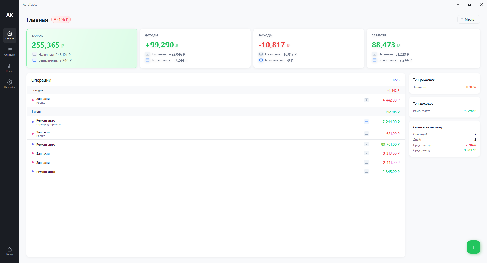
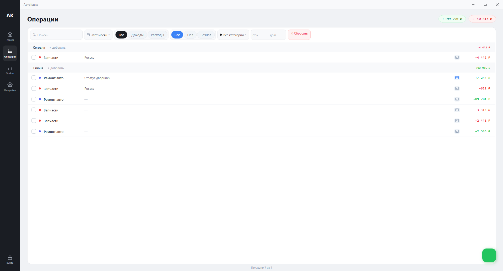
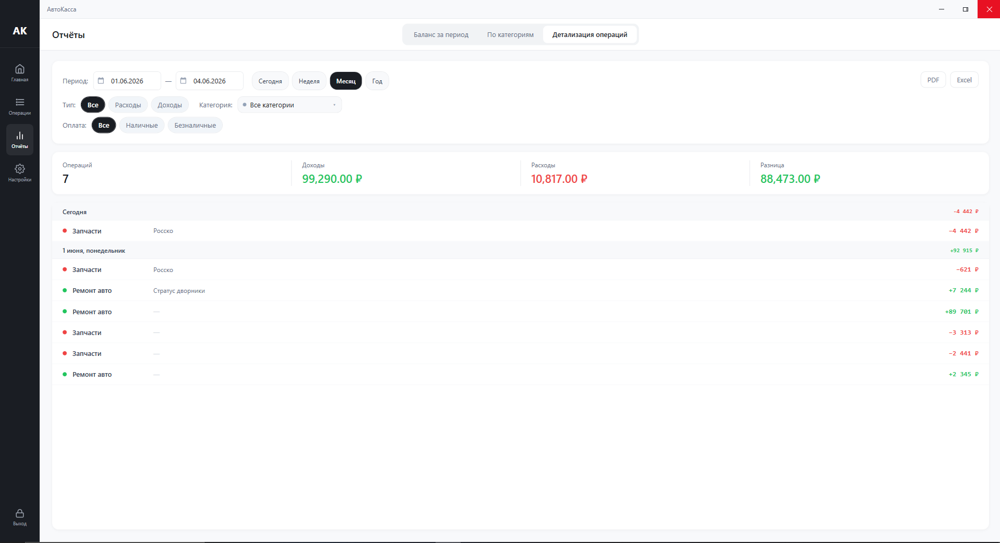

<div align="center">


# 💰 AutoKassa

**Десктопное приложение для учёта финансов автосервиса**

[](https://github.com/kommo1337/AutoKassa/actions)
[](https://github.com/kommo1337/AutoKassa/releases)
[](LICENSE)
[](https://dotnet.microsoft.com/)
[](https://github.com/dotnet/wpf)
[](https://sqlite.org/)

</div>

---

## 📋 Описание

**AutoKassa** — это современное WPF-приложение для учёта доходов и расходов автосервиса. Работает локально, хранит данные в SQLite-базе; для бэкапа доступна опциональная облачная копия на Яндекс Диск.

- 🔒 Защита паролем с автоблокировкой экрана
- 📊 Наглядный дашборд с ключевыми показателями
- 📁 Экспорт отчётов в PDF и Excel
- 💾 Резервное копирование: локально и на Яндекс Диск
- ⚡ Быстрая работа благодаря локальной SQLite

---

## 🖼️ Скриншоты

### Главный экран (Дашборд)


### Управление операциями


### Отчёты и аналитика


---

## ✨ Возможности

| Модуль | Описание |
|--------|----------|
| **📊 Дашборд** | Сводка баланса, доходов, расходов, топ категорий и последние операции |
| **📝 Операции** | CRUD-операции с фильтрацией, полнотекстовым поиском (FTS5), пагинацией и soft-delete |
| **💳 Кредитные карты** | Учёт карт, лимитов, кредитных покупок, минимальных платежей и погашений |
| **🤝 Долги и контрагенты** | Дебиторская/кредиторская задолженность, статусы, погашения, справочник контрагентов |
| **🧾 Сверка кассы** | Проверка наличных, безналичных, кредитного долга и чистого баланса на дату |
| **📂 Категории** | Управление категориями доходов/расходов с цветами и сортировкой |
| **📈 Отчёты** | Баланс за период, структура по категориям, детализация операций |
| **📤 Экспорт** | Выгрузка отчётов в PDF (QuestPDF) и Excel (ClosedXML) |
| **💾 Резервное копирование** | Локальные снимки SQLite с ротацией + опциональная облачная копия на Яндекс Диск (OAuth 2.0 + PKCE, только папка приложения) |
| **⚙️ Настройки** | Темы, резервное копирование, автоблокировка, экспорт/импорт JSON |
| **🔐 Безопасность** | BCrypt-хеширование паролей, секретный вопрос, автоблокировка по таймауту |

---

## 💾 Резервное копирование

Локальный бэкап работает как раньше: согласованный снимок SQLite, ротация по количеству копий, проверка срока при запуске и раз в час. Дополнительно можно включить **облачную копию на Яндекс Диск** — в раздел «Настройки → Резервное копирование → Яндекс Диск».

Как это работает:

- Авторизация — OAuth 2.0 + PKCE через системный браузер; приложение запрашивает доступ **только к папке приложения** (`app:/`) на Яндекс Диске.
- Общий `client_secret` не встраивается, refresh-token не хранится — при истечении или отзыве токена нужен повторный вход (кнопка «Подключить»).
- Access-token шифруется DPAPI (привязка к текущему пользователю Windows) и сохраняется локально в `%LOCALAPPDATA%\AutoKassa\Secrets\`.
- Перед отправкой снимок проверяется (`PRAGMA integrity_check`), после выгрузки сверяются имя, размер и MD5; неотправленный файл остаётся в локальной очереди и повторяется после сбоя или перезапуска.
- В облаке хранятся только файлы `AutoKassa_Backup_*.db`; ротация удаляет старые копии сверх лимита, заданного общей настройкой.

Важные ограничения:

- ⏰ Автоматические копии создаются **только при запущенном приложении** (проверка при старте и раз в час). Служба Windows и планировщик задач не используются.
- 🔓 Облачный `.db` **не шифруется дополнительно**: на Диске лежит обычный файл базы (передача по HTTPS). Убедись, что доверяешь аккаунту Яндекса.
- 🔑 DPAPI привязан к пользователю Windows: при смене профиля Windows подключение нужно выполнить заново.
- 📥 Восстановление из облака — ручное: скачай `.db` с Диска и восстанови его существующей командой восстановления из локального бэкапа.
- Для подключения нужен собственный `ClientId` от [oauth.yandex.ru](https://oauth.yandex.ru) с Redirect URI `https://oauth.yandex.ru/verification_code`. Его можно задать в `appsettings.json` до сборки/поставки либо ввести прямо в приложении: настройки → Яндекс Диск → «Подключить» откроет диалог ввода, значение сохранится на этом компьютере (в профиле пользователя) и перекроет `appsettings.json`.

---

## 🚀 Быстрый старт

### Портативная версия

1. Скачай `AutoKassa_Portable.zip` из [Releases](../../releases)
2. Распакуй в любую папку
3. Запусти `AutoKassa.exe`

### Сборка из исходников

```bash
# Клонирование репозитория
git clone https://github.com/kommo1337/AutoKassa.git
cd AutoKassa

# Сборка решения
dotnet build

# Запуск приложения
dotnet run --project AutoKassa

# Запуск тестов
dotnet test
```

---

## 🛠️ Технологический стек

| Компонент | Технология |
|-----------|-----------|
| Платформа | .NET 10.0 |
| UI | WPF + XAML |
| ORM | Entity Framework Core 10 |
| База данных | SQLite |
| DI | Microsoft.Extensions.DependencyInjection |
| Графики | OxyPlot.Wpf |
| PDF-экспорт | QuestPDF |
| Excel-экспорт | ClosedXML |
| Хеширование | BCrypt.Net-Next |
| Логирование | Serilog |
| Тестирование | xUnit + FluentAssertions |

---

## 🏗️ Архитектура

Приложение построено на **MVVM** с использованием **Dependency Injection**:

- **Models** — сущности EF Core (`Transaction`, `Category`, `AppSettings`)
- **ViewModels** — бизнес-логика экранов, команды, свойства для биндинга
- **Views** — XAML-разметка (code-behind содержит только UI-логику)
- **Services** — доступ к данным и бизнес-логика

```
AutoKassa/
├── Models/          # Сущности БД и DTO
├── Services/        # Бизнес-логика и доступ к данным
├── ViewModels/      # MVVM ViewModels
├── Views/           # XAML-представления
├── Helpers/         # Конвертеры, команды, базовые классы
└── Migrations/      # EF Core миграции
```

---

## 🧪 Тестирование

```bash
# Все тесты
dotnet test

# Только сервисы
dotnet test --filter "FullyQualifiedName~Services"
```

Тесты используют SQLite in-memory (`:memory:`) с автоматическим созданием seed-данных.

---

## 📦 Структура базы данных

- **Transaction** — финансовые операции (доходы/расходы) с soft delete
- **Category** — категории с цветами, сортировкой и системным флагом
- **AppSettings** — настройки приложения (single-row, Id = 1)

---

## ⚠️ Требования

- Windows 10/11 (x64)
- [.NET 10.0 Desktop Runtime](https://dotnet.microsoft.com/download/dotnet/10.0)

---

<div align="center">

Сделано с ❤️ для автосервисов

</div>
