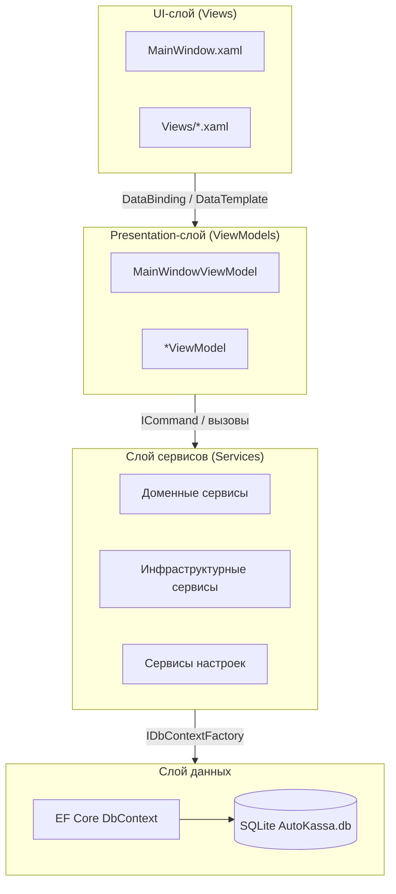
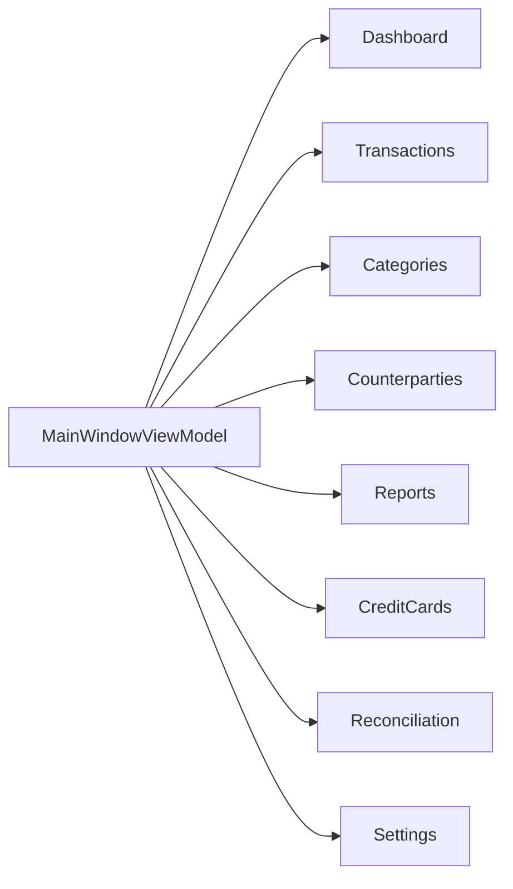
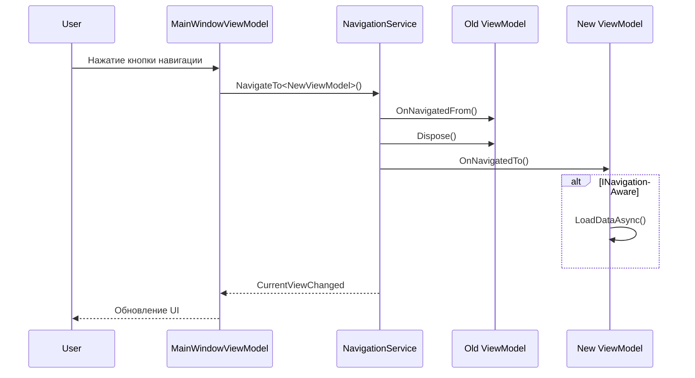
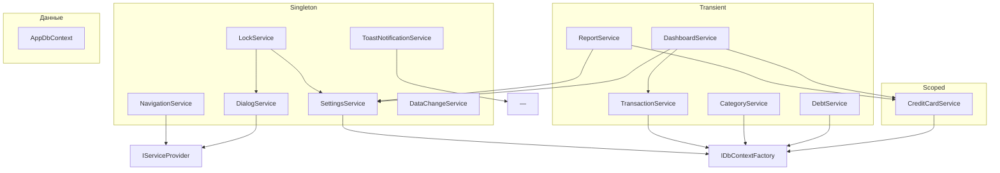

# 02-architecture — архитектура AutoKassa

> Этот файл описывает высокоуровневую архитектуру приложения: MVVM, DI, навигацию, жизненный цикл ViewModel и граф зависимостей.

---

## 1. Слои приложения

Приложение построено по паттерну MVVM с чётким разделением ответственности:



**Правила слоёв:**
- **View** не содержит бизнес-логики, только XAML и минимальный code-behind.
- **ViewModel** управляет состоянием экрана и командами, не знает о конкретных View.
- **Service** содержит бизнес-логику и доступ к данным.
- **DbContext** — единственная точка доступа к SQLite.

---

## 2. MVVM

### Базовые классы

- [`ViewModelBase`](../../AutoKassa/Helpers/ViewModelBase.cs) — реализует `INotifyPropertyChanged` и `INotifyDataErrorInfo`, содержит `SetProperty<T>`.
- [`RelayCommand`](../../AutoKassa/Helpers/RelayCommand.cs) — синхронная команда.
- [`AsyncRelayCommand`](../../AutoKassa/Helpers/AsyncRelayCommand.cs) — асинхронная команда.

### Пример ViewModel

```csharp
// AutoKassa/ViewModels/TransactionEditViewModel.cs
public class TransactionEditViewModel : ViewModelBase
{
    private readonly ITransactionService _transactionService;

    public TransactionEditViewModel(ITransactionService transactionService, ...)
    {
        _transactionService = transactionService;
        SaveCommand = new RelayCommand(async _ => await SaveAsync(), _ => CanSave());
    }

    private async Task SaveAsync()
    {
        var transaction = BuildTransaction();
        SavedTransaction = await _transactionService.AddAsync(transaction);
    }
}
```

### Пример привязки View

```xml
<!-- AutoKassa/Views/TransactionEditView.xaml -->
<Button Content="Сохранить" Command="{Binding SaveCommand}"/>
```

---

## 3. Dependency Injection

Вся регистрация выполняется в [`App.xaml.cs`](../../AutoKassa/App.xaml.cs) → `ConfigureServices(IServiceCollection)`.

### Lifetime сервисов

| Lifetime | Когда использовать | Примеры |
|----------|-------------------|---------|
| `Singleton` | Сервисы с состоянием приложения, событийные шины | `NavigationService`, `SettingsService`, `ToastNotificationService`, `LockService`, `DataChangeService` |
| `Scoped` | Сервис, который должен жить в рамках одной области (например, отчёта) | `CreditCardService` |
| `Transient` | Сервисы без состояния, доменная логика | `TransactionService`, `CategoryService`, `ReportService`, `DashboardService` |

### Главное окно и фабрики

```csharp
// AutoKassa/App.xaml.cs (фрагмент)
services.AddSingleton<MainWindow>(provider =>
{
    var viewModel = provider.GetRequiredService<MainWindowViewModel>();
    var toastService = provider.GetRequiredService<IToastNotificationService>();
    return new MainWindow(viewModel, toastService);
});
```

### DbContext

```csharp
services.AddDbContext<AppDbContext>(ServiceLifetime.Transient);
services.AddDbContextFactory<AppDbContext>();
```

Singleton-сервисы (`SettingsService`) используют `IDbContextFactory<AppDbContext>` для создания контекста на каждый вызов.

---

## 4. Навигация

### NavigationService

[`NavigationService`](../../AutoKassa/Services/NavigationService.cs) — Singleton, управляет текущим ViewModel.

```csharp
public void NavigateTo<TViewModel>() where TViewModel : ViewModelBase
{
    if (oldView is INavigationAware oldNav)
        oldNav.OnNavigatedFrom();

    _currentView = viewModel;

    if (viewModel is INavigationAware newNav)
        newNav.OnNavigatedTo();

    DisposeViewModel(oldView);
}
```

### Главное окно

[`MainWindow.xaml`](../../AutoKassa/MainWindow.xaml) содержит:
- Тёмный сайдбар шириной 76px с кнопками навигации.
- Кастомный тайтлбар через `WindowChrome`.
- `ContentControl` с `DataTemplate` для каждого главного экрана.

```xml
<ContentControl Content="{Binding CurrentView}">
    <ContentControl.Resources>
        <DataTemplate DataType="{x:Type vm:DashboardViewModel}">
            <views:DashboardView/>
        </DataTemplate>
        <!-- ... -->
    </ContentControl.Resources>
</ContentControl>
```

### Главные экраны

| Экран | ViewModel | View |
|-------|-----------|------|
| Главная | [`DashboardViewModel`](../../AutoKassa/ViewModels/DashboardViewModel.cs) | [`DashboardView.xaml`](../../AutoKassa/Views/DashboardView.xaml) |
| Операции | [`TransactionsViewModel`](../../AutoKassa/ViewModels/TransactionsViewModel.cs) | [`TransactionsView.xaml`](../../AutoKassa/Views/TransactionsView.xaml) |
| Категории | [`CategoriesViewModel`](../../AutoKassa/ViewModels/CategoriesViewModel.cs) | [`CategoriesView.xaml`](../../AutoKassa/Views/CategoriesView.xaml) |
| Контрагенты | [`CounterpartiesViewModel`](../../AutoKassa/ViewModels/CounterpartiesViewModel.cs) | [`CounterpartiesView.xaml`](../../AutoKassa/Views/CounterpartiesView.xaml) |
| Отчёты | [`ReportsViewModel`](../../AutoKassa/ViewModels/ReportsViewModel.cs) | [`ReportsView.xaml`](../../AutoKassa/Views/ReportsView.xaml) |
| Кредитные карты | [`CreditCardsViewModel`](../../AutoKassa/ViewModels/CreditCardsViewModel.cs) | [`CreditCardsView.xaml`](../../AutoKassa/Views/CreditCardsView.xaml) |
| Сверка кассы | [`ReconciliationViewModel`](../../AutoKassa/ViewModels/ReconciliationViewModel.cs) | [`ReconciliationView.xaml`](../../AutoKassa/Views/ReconciliationView.xaml) |
| Настройки | [`SettingsViewModel`](../../AutoKassa/ViewModels/SettingsViewModel.cs) | [`SettingsView.xaml`](../../AutoKassa/Views/SettingsView.xaml) |

Полный список: [`json/viewmodels.json`](json/viewmodels.json).

### Граф навигации



---

## 5. Жизненный цикл ViewModel

### INavigationAware

Экраны, реагирующие на смену вкладки, реализуют [`INavigationAware`](../../AutoKassa/Services/INavigationAware.cs):

```csharp
public interface INavigationAware
{
    void OnNavigatedTo();
    void OnNavigatedFrom();
}
```

### IAsyncInitializable

Для асинхронной инициализации при первом показе используется [`IAsyncInitializable`](../../AutoKassa/ViewModels/IAsyncInitializable.cs):

```csharp
public interface IAsyncInitializable
{
    Task InitializeAsync();
}
```

### Dispose

ViewModelBase реализует `IDisposable`. При уходе с экрана `NavigationService` вызывает `DisposeViewModel(oldView)`, который отписывается от событий и освобождает ресурсы.

### Схема жизненного цикла



---

## 6. Уведомления об изменениях данных

[`DataChangeService`](../../AutoKassa/Services/IDataChangeService.cs) — Singleton, публикует событие `DataChanged` после изменений операций, категорий, настроек.

```csharp
public interface IDataChangeService
{
    event Action DataChanged;
    void NotifyDataChanged();
}
```

Экраны подписываются на это событие и перезагружаются при необходимости.

---

## 7. Граф DI-зависимостей ключевых сервисов



Полный граф зависимостей: [`json/relationships.json`](json/relationships.json).

---

## 8. Фабрики ViewModel

Для избежания статического Service Locator используются фабрики:

- [`IReportViewModelFactory`](../../AutoKassa/ViewModels/Reports/IReportViewModelFactory.cs) — создаёт отчётные VM.
- [`ITransactionEditViewModelFactory`](../../AutoKassa/Services/Transactions/ITransactionEditViewModelFactory.cs) — создаёт VM редактора операции.

```csharp
// AutoKassa/Services/Transactions/ITransactionEditViewModelFactory.cs
public interface ITransactionEditViewModelFactory
{
    TransactionEditViewModel CreateForAdd();
    TransactionEditViewModel CreateForEdit(Transaction transaction);
}
```

---

## 9. Координаторы дашборда

Для декомпозиции тяжёлого `DashboardViewModel` выделены координаторы:

- [`IDashboardService`](../../AutoKassa/Services/Dashboard/IDashboardService.cs) — загрузка данных дашборда.
- [`IDashboardPeriodCoordinator`](../../AutoKassa/Services/Dashboard/IDashboardPeriodCoordinator.cs) — управление периодом.
- [`IDashboardTransactionCoordinator`](../../AutoKassa/Services/Dashboard/IDashboardTransactionCoordinator.cs) — операции добавления/удаления операций с undo-toast.

---

## 10. Горячие клавиши

В [`MainWindow.xaml`](../../AutoKassa/MainWindow.xaml) определены `InputBindings`:

| Сочетание | Действие |
|-----------|----------|
| `Ctrl + L` | Заблокировать приложение |
| `Alt + 1` | Главная |
| `Alt + 2` | Операции |
| `Alt + 3` | Отчёты |
| `Alt + 4` | Контрагенты |
| `Alt + 5` | Кредитные карты |
| `Alt + 6` | Сверка кассы |
| `Alt + 7` | Настройки |

---

> Последнее обновление: подэтапы 3.1–3.2 — Markdown-описания.
