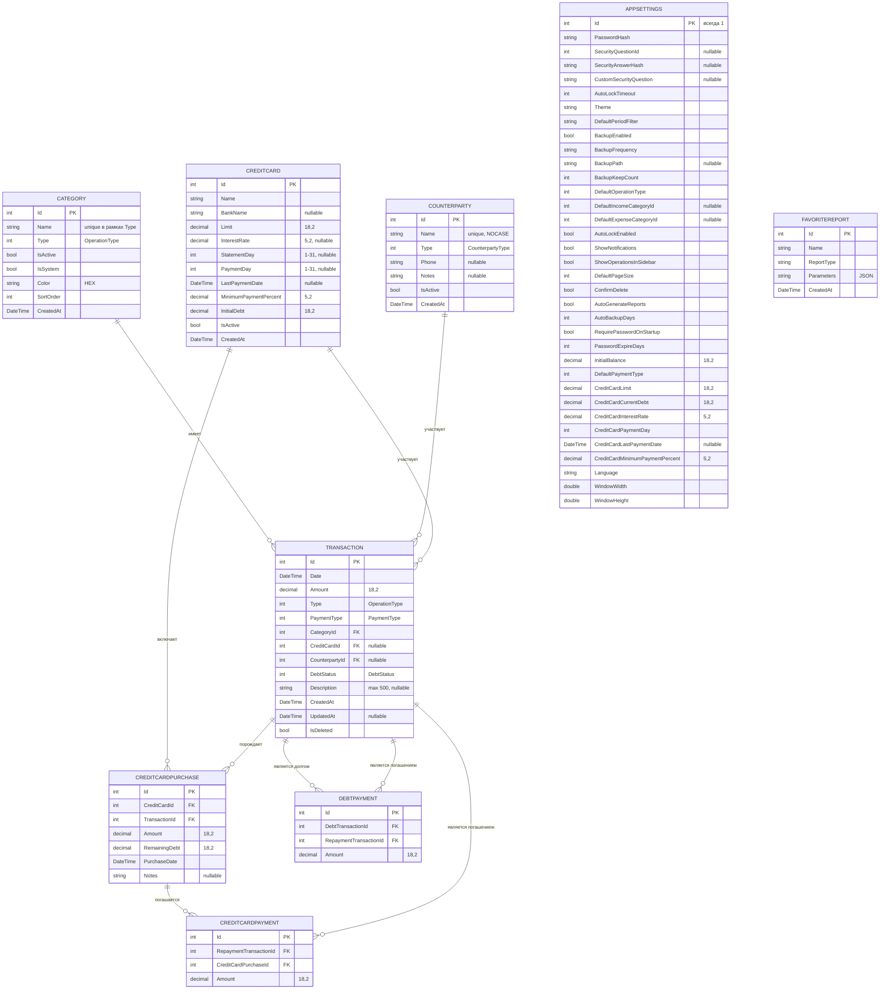

# 03-database — база данных AutoKassa

> Этот файл описывает схему SQLite-базы AutoKassa: ER-диаграмму, таблицы, связи, индексы, seed-данные и миграции.

---

## 1. Общие сведения

- **Провайдер:** SQLite (SourceGear.sqlite3).
- **Файл БД:** `AutoKassa.db` в папке приложения.
- **ORM:** Entity Framework Core 10.0.8.
- **Режим журнала:** WAL (`PRAGMA journal_mode=WAL`).
- **Контекст:** [`AppDbContext.cs`](../../AutoKassa/Services/AppDbContext.cs).
- **Полная схема в JSON:** [`json/models.json`](json/models.json).
- **Мягкое удаление:** реализовано через поле `IsDeleted` на уровне сервисов; глобальный query-фильтр EF не настроен.

---

## 2. ER-диаграмма



---

## 3. Таблицы

### 3.1. Categories

Справочник категорий доходов и расходов.

| Поле | Тип | Ограничения |
|------|-----|-------------|
| Id | int | PK |
| Name | string(100) | Обязательное |
| Type | int | OperationType, обязательное |
| IsActive | bool | Обязательное |
| IsSystem | bool | Обязательное |
| Color | string(7) | HEX |
| SortOrder | int | — |
| CreatedAt | DateTime | Обязательное |

**Seed-данные:** 11 системных категорий (4 дохода, 7 расходов, включая «Погашение кредита»). См. [`json/models.json`](json/models.json) → `Category.seedData`.

### 3.2. Transactions

Финансовые операции.

| Поле | Тип | Ограничения |
|------|-----|-------------|
| Id | int | PK |
| Date | DateTime | Обязательное, индекс |
| Amount | decimal(18,2) | Обязательное |
| Type | int | OperationType, индекс |
| PaymentType | int | PaymentType, default = Cash |
| CategoryId | int | FK → Category, обязательное |
| CreditCardId | int? | FK → CreditCard |
| CounterpartyId | int? | FK → Counterparty |
| DebtStatus | int | DebtStatus, default = NotDebt |
| Description | string(500) | nullable |
| CreatedAt | DateTime | Обязательное |
| UpdatedAt | DateTime? | nullable |
| IsDeleted | bool | default = false |

### 3.3. Counterparties

Контрагенты.

| Поле | Тип | Ограничения |
|------|-----|-------------|
| Id | int | PK |
| Name | string(150) | Unique, NOCASE |
| Type | int | CounterpartyType |
| Phone | string(20) | nullable |
| Notes | string(500) | nullable |
| IsActive | bool | default = true |
| CreatedAt | DateTime | Обязательное |

### 3.4. CreditCards

Кредитные карты.

| Поле | Тип | Ограничения |
|------|-----|-------------|
| Id | int | PK |
| Name | string(100) | Обязательное |
| BankName | string(100) | nullable |
| Limit | decimal(18,2) | Обязательное |
| InterestRate | decimal(5,2) | nullable |
| StatementDay | int? | 1–31 |
| PaymentDay | int? | 1–31 |
| LastPaymentDate | DateTime? | nullable |
| MinimumPaymentPercent | decimal(5,2) | Обязательное |
| InitialDebt | decimal(18,2) | Обязательное |
| IsActive | bool | Обязательное |
| CreatedAt | DateTime | Обязательное |

### 3.5. CreditCardPurchases

Покупки по кредитным картам.

| Поле | Тип | Ограничения |
|------|-----|-------------|
| Id | int | PK |
| CreditCardId | int | FK → CreditCard |
| TransactionId | int | FK → Transaction |
| Amount | decimal(18,2) | Обязательное |
| RemainingDebt | decimal(18,2) | Обязательное |
| PurchaseDate | DateTime | Обязательное |
| Notes | string(500) | nullable |

### 3.6. CreditCardPayments

Связь погашений с покупками (FIFO).

| Поле | Тип | Ограничения |
|------|-----|-------------|
| Id | int | PK |
| RepaymentTransactionId | int | FK → Transaction |
| CreditCardPurchaseId | int | FK → CreditCardPurchase |
| Amount | decimal(18,2) | Обязательное |

### 3.7. DebtPayments

Связь долговых операций и их погашений.

| Поле | Тип | Ограничения |
|------|-----|-------------|
| Id | int | PK |
| DebtTransactionId | int | FK → Transaction |
| RepaymentTransactionId | int | FK → Transaction |
| Amount | decimal(18,2) | Обязательное |

### 3.8. AppSettings

Глобальные настройки приложения. Всегда одна строка с `Id = 1`.

| Поле | Тип | Примечание |
|------|-----|------------|
| Id | int | PK, всегда 1 |
| PasswordHash | string(255) | BCrypt-хеш |
| SecurityQuestionId | int? | SecurityQuestion |
| SecurityAnswerHash | string(255) | BCrypt-хеш |
| ... | ... | См. полный список в [`json/models.json`](json/models.json) |

### 3.9. FavoriteReports

Избранные отчёты.

| Поле | Тип | Ограничения |
|------|-----|-------------|
| Id | int | PK |
| Name | string(100) | Обязательное |
| ReportType | string(50) | Обязательное |
| Parameters | string(2000) | JSON |
| CreatedAt | DateTime | Обязательное |

---

## 4. Связи и OnDelete

| Родитель | Зависимая | Тип | OnDelete | Примечание |
|----------|-----------|-----|----------|------------|
| Category | Transaction | 1:N | Restrict | Категорию нельзя удалить, если есть операции |
| CreditCard | Transaction | 1:N | Restrict | — |
| Counterparty | Transaction | 1:N | Restrict | — |
| CreditCard | CreditCardPurchase | 1:N | Restrict | — |
| Transaction | CreditCardPurchase | 1:1..N | Restrict | — |
| Transaction | CreditCardPayment | 1:N | Restrict | Погашение — операция |
| CreditCardPurchase | CreditCardPayment | 1:N | Cascade | При удалении покупки удаляются её погашения |
| Transaction | DebtPayment (Debt) | 1:N | Restrict | Долговая операция |
| Transaction | DebtPayment (Repayment) | 1:N | Restrict | Операция-погашение |

---

## 5. Индексы

### Transaction

- `IX_Transaction_Date`
- `IX_Transaction_Type`
- `IX_Transaction_CategoryId`
- `IX_Transaction_IsDeleted`
- `IX_Transaction_PaymentType`
- `IX_Transactions_CreditCardId`
- `IX_Transaction_CounterpartyId`
- `IX_Transaction_DebtStatus`
- `IX_Transaction_Date_IsDeleted`
- `IX_Transaction_Date_Type_IsDeleted`
- `IX_Transaction_Type_IsDeleted_Date`
- `IX_Transaction_CreatedAt`

### Category

- `UQ_Category_Name_Type` (unique)
- `IX_Category_Type`
- `IX_Category_IsActive`

### Counterparty

- `IX_Counterparty_Name` (unique)
- `IX_Counterparty_Type`
- `IX_Counterparty_IsActive`

### CreditCard

- `IX_CreditCard_IsActive`

### CreditCardPurchase

- `IX_CreditCardPurchase_CreditCardId`
- `IX_CreditCardPurchase_TransactionId`
- `IX_CreditCardPurchase_PurchaseDate`

### CreditCardPayment

- `IX_CreditCardPayment_RepaymentTransactionId_CreditCardPurchaseId` (unique)
- `IX_CreditCardPayment_RepaymentTransactionId`
- `IX_CreditCardPayment_CreditCardPurchaseId`

### DebtPayment

- `IX_DebtPayment_DebtTransactionId_RepaymentTransactionId` (unique)
- `IX_DebtPayment_DebtTransactionId`
- `IX_DebtPayment_RepaymentTransactionId`

---

## 6. Seed-данные

### Категории

При первом запуске создаются 11 системных категорий:

| Id | Название | Тип | Цвет |
|----|----------|-----|------|
| 1 | Ремонт авто | Income | #6366f1 |
| 2 | Ремонт мото | Income | #f59e0b |
| 3 | Диагностика | Income | #14b8a6 |
| 4 | Прочие доходы | Income | #94a3b8 |
| 5 | Запчасти | Expense | #ec4899 |
| 6 | Зарплата | Expense | #f97316 |
| 7 | Аренда | Expense | #8b5cf6 |
| 8 | Коммунальные услуги | Expense | #06b6d4 |
| 9 | Маркетинг | Expense | #84cc16 |
| 10 | Прочие расходы | Expense | #ef4444 |
| 11 | Погашение кредита | Expense | #64748b |

### AppSettings

Создаётся одна запись с `Id = 1` и значениями по умолчанию (светлая тема, таймаут блокировки 10 минут, начальный баланс 0 и т.д.).

---

## 7. Миграции

EF Core миграции применяются автоматически при запуске через [`SettingsService.MigrateAsync`](../../AutoKassa/Services/SettingsService.cs).

### Список миграций

| Миграция | Назначение |
|----------|------------|
| InitialCreate | Первоначальная схема |
| AddDefaultOperationSettings | Настройки операций по умолчанию |
| AddPaymentTypeAndCategoryColor | Тип оплаты и цвет категории |
| AddCategorySortOrder | Порядок сортировки категорий |
| AddInitialBalance | Начальный баланс |
| AddDefaultPaymentType | Тип оплаты по умолчанию |
| SettingsRedesign | Переработка настроек |
| Net10Migration | Переход на .NET 10 |
| AddCreditCardSupport | Кредитные карты |
| FixCreditCardPendingModel | Исправление модели кредитки |
| AddDebtSupport | Долги |
| AddCreditCardPayments | Погашения кредитных карт |
| CreditCardPaymentCascadeDelete | Каскадное удаление погашений |
| CreditCardPaymentNavigationFix | Исправление навигации погашений |
| AddTransactionsFts | FTS5-поиск по описаниям операций: виртуальная таблица `TransactionsFts` + триггеры синхронизации |

### Полнотекстовый поиск (FTS5)

Миграция `AddTransactionsFts` создаёт виртуальную таблицу `TransactionsFts` (`fts5("Description")`, токенизатор unicode61 — регистронезависимый, в т.ч. для кириллицы) и триггеры синхронизации с `Transactions`:

- `TransactionsFts_Insert` — `AFTER INSERT`;
- `TransactionsFts_Update` — `AFTER UPDATE OF "Description"`;
- `TransactionsFts_Delete` — `AFTER DELETE` (в проекте только soft delete, поэтому срабатывает редко; soft-deleted записи исключаются фильтром `IsDeleted` в запросе).

Поиск выполняется подзапросом `WHERE "Id" IN (SELECT rowid FROM "TransactionsFts" WHERE "TransactionsFts" MATCH ?)` в `TransactionService` (`BuildFtsMatchQuery` строит префиксные фразы). В EF-модели таблица не отображается — миграция содержит только raw SQL. В тестовых БД (`TestDatabase`, `EnsureCreated` не применяет миграции) те же объекты создаются SQL-константой `FtsSetupSql` — при изменении миграции синхронизируй её.

### Как создать новую миграцию

```bash
cd AutoKassa
dotnet ef migrations add <ИмяМиграции>
```

> Не забывай обновлять [`json/models.json`](json/models.json) → `migrations` после добавления миграции.

---

> Последнее обновление: подэтапы 3.1–3.2 — Markdown-описания.
