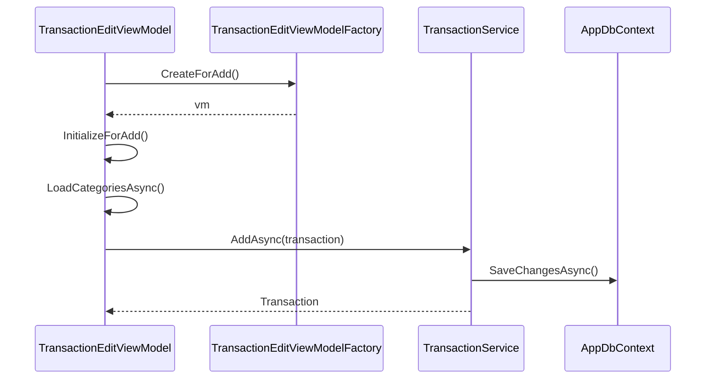
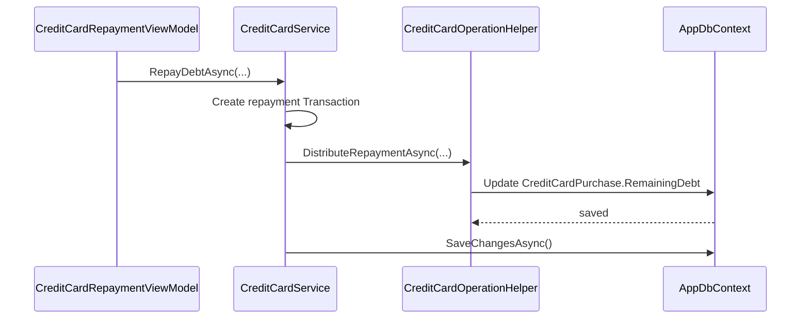
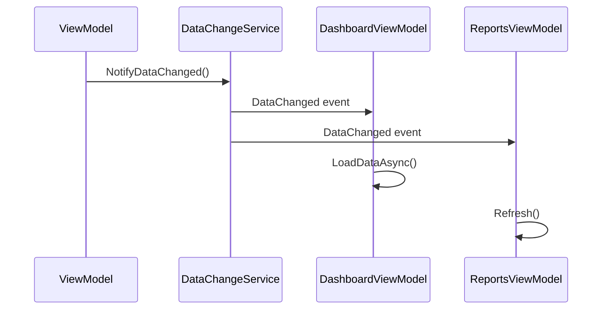

# 05-services — сервисы AutoKassa

> Этот файл описывает все сервисы приложения: их ответственность, lifetime, зависимости и ключевые методы. Полный машиночитаемый каталог см. в [`json/services.json`](json/services.json), граф зависимостей — в [`json/relationships.json`](json/relationships.json).

---

## 1. Категории сервисов

| Категория | Описание | Сервисы |
|-----------|----------|---------|
| Доменные | Бизнес-логика операций, категорий, долгов, кредиток, отчётов, дашборда | `TransactionService`, `CategoryService`, `CounterpartyService`, `DebtService`, `CreditCardService`, `ReportService`, `DashboardService`, `DashboardPeriodCoordinator`, `DashboardTransactionCoordinator` |
| Инфраструктурные | Навигация, диалоги, уведомления, блокировка, экспорт, события данных, буфер обмена | `NavigationService`, `DialogService`, `ToastNotificationService`, `LockService`, `ExportService`, `DataChangeService`, `ClipboardService` |
| Настройки и безопасность | Настройки, backup, пароли, инфо о программе | `SettingsService`, `PasswordService`, `SettingsMapper`, `SettingsValidator`, `AppInfoService`, `BackupCoordinator`, `CreditCardSettingsService` |
| Облачное резервное копирование | Выгрузка SQLite-снимков в папку приложения на Яндекс Диске (OAuth/PKCE, REST API) | `YandexDiskAuthService`, `YandexDiskApiClient`, `YandexDiskBackupService`, `DpapiYandexDiskTokenStore`, `YandexDiskOptions` |
| Расписание автобэкапа | Координатор: немедленная проверка при старте и раз в час, сериализация запусков, остановка при выходе | `AutomaticBackupService` |
| Фабрики | Создание VM через DI | `ReportViewModelFactory`, `TransactionEditViewModelFactory` |
| База данных | EF Core DbContext | `AppDbContext` |

---

## 2. Доменные сервисы

### 2.1. TransactionService

**Файл:** [`AutoKassa/Services/TransactionService.cs`](../../AutoKassa/Services/TransactionService.cs)

**Интерфейс:** `ITransactionService`

**Lifetime:** Transient

**Зависимости:** `IDbContextFactory<AppDbContext>`

**Ответственность:** CRUD операций, фильтрация, пагинация, SQL-агрегации, soft delete/restore, обработка долговых операций и операций по кредитным картам.

**Ключевые методы:**

| Метод | Описание |
|-------|----------|
| `GetTransactionsAsync(filters, ct)` | Список операций с фильтрами |
| `GetTotalCountAsync(filters, ct)` | Общее количество по фильтрам |
| `GetByIdAsync(id, ct)` | Операция по ID |
| `AddAsync(transaction, ct)` | Добавление операции |
| `UpdateAsync(transaction, ct)` | Обновление операции |
| `DeleteAsync(id, ct)` | Soft delete |
| `DeleteRangeAsync(ids, ct)` | Массовый soft delete одним контекстом и одной транзакцией БД (с той же бизнес-логикой, что у `DeleteAsync`) |
| `RestoreAsync(id, ct)` | Восстановление удалённой операции |
| `RestoreRangeAsync(ids, ct)` | Массовое восстановление одним контекстом и одной транзакцией БД (с той же бизнес-логикой, что у `RestoreAsync`; статусы долгов пересчитываются по разу на долг) |
| `IsRepaymentTransactionAsync(id, ct)` | Является ли операция погашением |
| `GetRecentAsync(count, ct)` | Последние N операций |
| `GetPeriodTotalsAsync(from, to, paymentType, ct)` | Итоги за период |
| `GetPeriodTotalsByPaymentTypeAsync(from, to, ct)` | Итоги за период, сгруппированные по типу оплаты (один запрос) |
| `GetDailyTotalsAsync(from, to, paymentType, ct)` | Дневные итоги |
| `GetTopCategoriesAsync(from, to, type, count, paymentType, ct)` | Топ категорий |

> Полный каталог методов см. в [`json/services.json`](json/services.json) → `TransactionService`.

**Особенности:**
- Операции с `PaymentType.Debt` получают `DebtStatus.Active`.
- Операции с `PaymentType.CreditCard` создают `CreditCardPurchase`.
- Удаление операции — только soft delete.
- Поиск по `SearchText` выполняется через SQLite FTS5 (`TransactionsFts`, unicode61) — регистронезависимо, в т.ч. для кириллицы, по префиксам слов.

### 2.2. TransactionListService

**Файл:** [`AutoKassa/Services/Transactions/TransactionListService.cs`](../../AutoKassa/Services/Transactions/TransactionListService.cs)

**Интерфейс:** `ITransactionListService`

**Lifetime:** Transient

**Зависимости:** `ITransactionService`

**Ответственность:** Фасад для загрузки страниц операций с учётом фильтров и пагинации.

**Ключевые методы:**
- `LoadFirstPageAsync(request, ct)`
- `LoadNextPageAsync(request, ct)`

### 2.3. TransactionGroupingService

**Файл:** [`AutoKassa/Services/Transactions/TransactionGroupingService.cs`](../../AutoKassa/Services/Transactions/TransactionGroupingService.cs)

**Интерфейс:** `ITransactionGroupingService`

**Lifetime:** Transient

**Зависимости:** `IToastNotificationService`

**Ответственность:** Группировка операций по дням, расчёт итогов, формирование VM-групп с inline-формами.

### 2.4. InlineTransactionService

**Файл:** [`AutoKassa/Services/Transactions/InlineTransactionService.cs`](../../AutoKassa/Services/Transactions/InlineTransactionService.cs)

**Интерфейс:** `IInlineTransactionService`

**Lifetime:** Transient

**Зависимости:** `ITransactionService`

**Ответственность:** Валидация и сохранение операций, добавленных через inline-форму.

### 2.5. TransactionSelectionService

**Файл:** [`AutoKassa/Services/Transactions/TransactionSelectionService.cs`](../../AutoKassa/Services/Transactions/TransactionSelectionService.cs)

**Интерфейс:** `ITransactionSelectionService`

**Lifetime:** Transient

**Зависимости:** —

**Ответственность:** Массовое выделение операций в группах.

### 2.6. CategoryService

**Файл:** [`AutoKassa/Services/CategoryService.cs`](../../AutoKassa/Services/CategoryService.cs)

**Интерфейс:** `ICategoryService`

**Lifetime:** Transient

**Зависимости:** `IDbContextFactory<AppDbContext>`, `ReferenceDataCache`

**Ответственность:** Управление справочником категорий. Чтения списков (`GetAllAsync`/`GetActiveAsync`/`GetByTypeAsync`) идут через [`ReferenceDataCache`](../../AutoKassa/Services/ReferenceDataCache.cs) (сортировка в памяти повторяет SQL-порядок); мутации инвалидируют кэш после `SaveChanges`.

**Ключевые методы:**

| Метод | Описание |
|-------|----------|
| `GetAllAsync()` | Все категории (из кэша) |
| `GetActiveAsync()` | Активные категории (из кэша) |
| `GetByTypeAsync(type, activeOnly)` | По типу (из кэша) |
| `GetCountAsync()` | Количество категорий (SQL COUNT) |
| `AddAsync(category)` | Добавить |
| `UpdateAsync(category)` | Обновить |
| `DeleteAsync(id)` | Удалить (с проверками) |
| `DeactivateAsync(id)` | Деактивировать |
| `ReorderAsync(updates)` | Изменить порядок |

**Ограничения:**
- Системные категории нельзя удалить.
- Нельзя удалить категорию по умолчанию.
- Название уникально в рамках типа.

### 2.7. CounterpartyService

**Файл:** [`AutoKassa/Services/CounterpartyService.cs`](../../AutoKassa/Services/CounterpartyService.cs)

**Интерфейс:** `ICounterpartyService`

**Lifetime:** Transient

**Зависимости:** `IDbContextFactory<AppDbContext>`, `ReferenceDataCache`

**Ответственность:** Справочник контрагентов. Чтения списков (`GetAllAsync`/`GetActiveAsync`) идут через `ReferenceDataCache`; мутации инвалидируют кэш после `SaveChanges`.

**Ключевые методы:**
- `GetAllAsync(ct)` (из кэша)
- `GetActiveAsync(type, ct)` (из кэша)
- `AddAsync(counterparty, ct)`
- `UpdateAsync(counterparty, ct)`
- `DeleteAsync(id, ct)`

**Ограничение:** нельзя удалить контрагента с операциями.

### 2.8. DebtService

**Файл:** [`AutoKassa/Services/DebtService.cs`](../../AutoKassa/Services/DebtService.cs)

**Интерфейс:** `IDebtService`

**Lifetime:** Transient

**Зависимости:** `IDbContextFactory<AppDbContext>`

**Ответственность:** Управление долгами (дебиторская/кредиторская задолженность).

**Ключевые методы:**

| Метод | Описание |
|-------|----------|
| `GetDebtsAsync(direction, counterpartyId, status, pageNumber, pageSize, ct)` | Список долгов |
| `RepayAsync(debtTransactionId, amount, paymentType, date, description, ct)` | Создать погашение |
| `WriteOffAsync(debtTransactionId, ct)` | Списать долг |
| `GetRemainingAmountAsync(id, ct)` | Остаток по долгу |
| `RecalculateStatusAsync(id, ct)` | Пересчитать статус |

**Особенности:**
- `Income + Debt` → нам должны (дебиторка).
- `Expense + Debt` → мы должны (кредиторка).
- Частичные погашения через `DebtPayment`.
- Списать можно только долг без погашений.

### 2.9. CreditCardService

**Файл:** [`AutoKassa/Services/CreditCardService.cs`](../../AutoKassa/Services/CreditCardService.cs)

**Интерфейс:** `ICreditCardService`

**Lifetime:** Transient

**Зависимости:** `IDbContextFactory<AppDbContext>`, `ReferenceDataCache`

**Ответственность:** Управление кредитными картами, покупками и погашениями. Чтение списка карт (`GetAllAsync`) — через `ReferenceDataCache`; мутации инвалидируют кэш после `SaveChanges`. `GetCardWithPurchasesAsync` загружает покупки filtered Include с лимитом `MaxCardPurchases = 500` (последние по дате).

**Ключевые методы:**

| Метод | Описание |
|-------|----------|
| `GetAllAsync(ct)` | Все карты |
| `GetByIdAsync(id, ct)` | Карта по ID |
| `GetCardPurchasesCountAsync(cardId, ct)` | Общее количество покупок карты (SQL COUNT) — для пометки об усечении истории лимитом `MaxCardPurchases` |
| `CreateAsync(card, ct)` | Создать |
| `UpdateAsync(card, ct)` | Обновить |
| `DeleteAsync(id, ct)` | Деактивировать |
| `GetCurrentDebtAsync(id, ct)` | Текущий долг |
| `GetAvailableLimitAsync(id, ct)` | Доступный лимит |
| `GetMinimumPaymentAsync(id, ct)` | Минимальный платёж |
| `GetCardsMetricsAsync(ct)` | Метрики по всем картам одним пакетом (без N+1) |
| `RepayDebtAsync(id, amount, paymentType, date, description, ct)` | Погасить долг |
| `DistributeRepaymentForTransactionAsync(...)` | FIFO-распределение |

> FIFO-распределение погашений реализовано в статическом helper'е [`CreditCardOperationHelper`](../../AutoKassa/Services/CreditCardOperationHelper.cs); см. также [`json/services.json`](json/services.json) → `CreditCardOperationHelper`.

### 2.10. ReportService

**Файл:** [`AutoKassa/Services/ReportService.cs`](../../AutoKassa/Services/ReportService.cs)

**Интерфейс:** `IReportService`

**Lifetime:** Transient

**Зависимости:** `IDbContextFactory<AppDbContext>`, `ISettingsService`, `ICreditCardService`

**Ответственность:** Формирование отчётов.

**Ключевые методы:**

| Метод | Описание |
|-------|----------|
| `GenerateBalanceReportAsync(from, to, paymentType, ct)` | Баланс за период |
| `GenerateCategoryReportAsync(from, to, operationType, paymentType, ct)` | Структура по категориям (SQL `GroupBy(CategoryId)` + join к `Categories`, без материализации операций) |
| `GetCategoryTransactionsAsync(categoryId, from, to, operationType, paymentType, take, ct)` | Операции категории для ленивой загрузки при раскрытии (лимит `MaxCategoryTransactions`, `OrderBy` до `Take`) |
| `GenerateTransactionDetailReportAsync(...)` | Детализация операций (лимит `MaxDetailTransactions = 1000`, пометка усечения `TruncationNote`) |
| `GenerateDebtReportAsync(...)` | Отчёт по долгам |
| `GetReconciliationDataAsync(date, ct)` | Сверка кассы |

**Особенность:** долговые операции исключаются из баланса.

### 2.11. DashboardService

**Файл:** [`AutoKassa/Services/Dashboard/DashboardService.cs`](../../AutoKassa/Services/Dashboard/DashboardService.cs)

**Интерфейс:** `IDashboardService`

**Lifetime:** Transient

**Зависимости:** `ITransactionService`, `ISettingsService`, `ICreditCardService`

**Ответственность:** Загрузка всех данных главного экрана. Сводка и счётчики операций считаются одним запросом (`GetSummaryAsync`), остатки наличных/безналичных — одним запросом `GetPeriodTotalsByPaymentTypeAsync` (без полных сканов истории). Построения графиков в сервисе нет (мёртвый `BuildChartModelAsync` удалён).

**Ключевой метод:** `LoadDashboardDataAsync(dateFrom, dateTo, ct)`.

### 2.12. DashboardPeriodCoordinator

**Файл:** [`AutoKassa/Services/Dashboard/DashboardPeriodCoordinator.cs`](../../AutoKassa/Services/Dashboard/DashboardPeriodCoordinator.cs)

**Интерфейс:** `IDashboardPeriodCoordinator`

**Lifetime:** Transient

**Зависимости:** —

**Ответственность:** Расчёт периода дашборда по пресетам.

**Ключевые методы:**
- `SetPeriod(periodType)`
- `SetCustomPeriod(from, to)`

### 2.13. DashboardTransactionCoordinator

**Файл:** [`AutoKassa/Services/Dashboard/DashboardTransactionCoordinator.cs`](../../AutoKassa/Services/Dashboard/DashboardTransactionCoordinator.cs)

**Интерфейс:** `IDashboardTransactionCoordinator`

**Lifetime:** Transient

**Зависимости:** `ITransactionService`, `ITransactionEditViewModelFactory`, `IToastNotificationService`

**Ответственность:** Операции добавления/удаления операций на дашборде с undo-toast и оптимистичным обновлением.

---

## 3. Инфраструктурные сервисы

### 3.1. NavigationService

**Файл:** [`AutoKassa/Services/NavigationService.cs`](../../AutoKassa/Services/NavigationService.cs)

**Интерфейс:** `INavigationService`

**Lifetime:** Singleton

**Зависимости:** `IServiceProvider`

**Ответственность:** Управление текущим ViewModel, вызов `INavigationAware`, Dispose старых VM (кроме page ViewModel с маркером [`IPageViewModel`](../../AutoKassa/ViewModels/IPageViewModel.cs) — они Singleton и не диспозятся при навигации; повторный `NavigateTo` на уже активную вкладку — no-op).

### 3.2. DialogService

**Файл:** [`AutoKassa/Services/DialogService.cs`](../../AutoKassa/Services/DialogService.cs)

**Интерфейс:** `IDialogService`

**Lifetime:** Singleton

**Зависимости:** `IServiceProvider`

**Ответственность:** Показ модальных диалогов и экрана блокировки.

### 3.3. ToastNotificationService

**Файл:** [`AutoKassa/Services/ToastNotificationService.cs`](../../AutoKassa/Services/ToastNotificationService.cs)

**Интерфейс:** `IToastNotificationService`

**Lifetime:** Singleton

**Ответственность:** Событийная шина для toast-уведомлений, включая undo-подтверждение удаления.

### 3.4. LockService

**Файл:** [`AutoKassa/Services/LockService.cs`](../../AutoKassa/Services/LockService.cs)

**Интерфейс:** `ILockService`

**Lifetime:** Singleton

**Зависимости:** `IServiceProvider`, `IDialogService`, `IPasswordService`, `ISettingsService`

**Ответственность:** Автоблокировка по таймауту неактивности.

### 3.5. ExportService

**Файл:** [`AutoKassa/Services/ExportService.cs`](../../AutoKassa/Services/ExportService.cs)

**Интерфейс:** `IExportService`

**Lifetime:** Singleton

**Ответственность:** Экспорт отчётов в PDF (QuestPDF) и Excel (ClosedXML). Excel-методы пишут данные пакетно (`InsertData`), стили назначаются на диапазоны/колонки, ширины колонок фиксированные (`AdjustToContents` не используется).

### 3.6. DataChangeService

**Файл:** [`AutoKassa/Services/IDataChangeService.cs`](../../AutoKassa/Services/IDataChangeService.cs)

**Интерфейс:** `IDataChangeService`

**Lifetime:** Singleton

**Ответственность:** Уведомление подписчиков об изменениях данных.

### 3.7. ReferenceDataCache

**Файл:** [`AutoKassa/Services/ReferenceDataCache.cs`](../../AutoKassa/Services/ReferenceDataCache.cs)

**Интерфейс:** нет (конкретный класс)

**Lifetime:** Singleton

**Зависимости:** `IDbContextFactory<AppDbContext>`, `IDataChangeService`

**Ответственность:** Кэш справочников (категории, контрагенты, кредитные карты), чтобы несколько VM и редакторы не грузили их повторно. Ленивая загрузка под `SemaphoreSlim`, наружу отдаёт **клоны** сущностей (мутации в VM не портят кэш). Инвалидация: полный сброс по `IDataChangeService.DataChanged` + точечная в мутациях `CategoryService`/`CounterpartyService`/`CreditCardService` после `SaveChanges`.

### 3.8. SqlitePragmaInterceptor

**Файл:** [`AutoKassa/Services/SqlitePragmaInterceptor.cs`](../../AutoKassa/Services/SqlitePragmaInterceptor.cs)

**Интерфейс:** `IDbConnectionInterceptor` (EF Core)

**Lifetime:** один экземпляр в `DbContextOptions` — регистрация через `options.AddInterceptors(new SqlitePragmaInterceptor())` в `App.ConfigureServices` (`AddPooledDbContextFactory`)

**Ответственность:** Применяет per-connection PRAGMA SQLite (`synchronous=NORMAL`, `temp_store=MEMORY`, `cache_size=-8000`) при каждом открытии соединения (`ConnectionOpened`/`ConnectionOpenedAsync`) — эти настройки живут в рамках соединения и не сохраняются в файле БД. `journal_mode=WAL`, напротив, персистентна и выставляется один раз в `SettingsService.MigrateAsync`.

---

## 4. Сервисы настроек и безопасности

### 4.1. SettingsService

**Файл:** [`AutoKassa/Services/SettingsService.cs`](../../AutoKassa/Services/SettingsService.cs)

**Интерфейс:** `ISettingsService`

**Lifetime:** Singleton

**Зависимости:** `IDbContextFactory<AppDbContext>`

**Ответственность:** Управление `AppSettings`, кеширование, миграции, import/export JSON, backup/restore БД.

### 4.2. PasswordService

**Файл:** [`AutoKassa/Services/PasswordService.cs`](../../AutoKassa/Services/PasswordService.cs)

**Интерфейс:** `IPasswordService`

**Lifetime:** Singleton

**Ответственность:** BCrypt-хеширование и проверка паролей/ответов.

### 4.3. SettingsMapper

**Файл:** [`AutoKassa/Services/Settings/SettingsMapper.cs`](../../AutoKassa/Services/Settings/SettingsMapper.cs)

**Интерфейс:** `ISettingsMapper`

**Lifetime:** Singleton

**Ответственность:** Маппинг `AppSettings` ↔ `SettingsViewModel`.

### 4.4. SettingsValidator

**Файл:** [`AutoKassa/Services/Settings/SettingsValidator.cs`](../../AutoKassa/Services/Settings/SettingsValidator.cs)

**Интерфейс:** `ISettingsValidator`

**Lifetime:** Singleton

**Ответственность:** Валидация значений настроек.

### 4.5. AppInfoService

**Файл:** [`AutoKassa/Services/Settings/AppInfoService.cs`](../../AutoKassa/Services/Settings/AppInfoService.cs)

**Интерфейс:** `IAppInfoService`

**Lifetime:** Singleton

**Зависимости:** `ISettingsService`, `ITransactionService`, `ICategoryService`

**Ответственность:** Формирование информации «О программе».

### 4.6. BackupCoordinator

**Файл:** [`AutoKassa/Services/Backup/BackupCoordinator.cs`](../../AutoKassa/Services/Backup/BackupCoordinator.cs)

**Интерфейс:** `IBackupCoordinator`

**Lifetime:** Singleton

**Зависимости:** `IDialogService`, `ISettingsService`, `IToastNotificationService`

**Ответственность:** UI-координация backup/restore с диалогами.

### 4.7. CreditCardSettingsService

**Файл:** [`AutoKassa/Services/CreditCards/CreditCardSettingsService.cs`](../../AutoKassa/Services/CreditCards/CreditCardSettingsService.cs)

**Интерфейс:** `ICreditCardSettingsService`

**Lifetime:** Transient

**Зависимости:** `ICreditCardService`

**Ответственность:** Синхронизация основной кредитной карты из `AppSettings`.

### 4.8. YandexDiskOptions

**Файл:** [`AutoKassa/Services/Backup/YandexDisk/YandexDiskOptions.cs`](../../AutoKassa/Services/Backup/YandexDisk/YandexDiskOptions.cs)

**Интерфейс:** — (POCO-опции)

**Lifetime:** Singleton

**Зависимости:** `appsettings.json` (секция `YandexDisk`)

**Ответственность:** Публичные настройки интеграции с Яндекс Диском: `ClientId`, URL OAuth/API, Redirect URI, scope `cloud_api:disk.app_folder`. Секретов не содержит; загрузка через `System.Text.Json` (`Load()`), отсутствующий файл/секция → дефолты с пустым `ClientId`.

### 4.9. DpapiYandexDiskTokenStore

**Файл:** [`AutoKassa/Services/Backup/YandexDisk/DpapiYandexDiskTokenStore.cs`](../../AutoKassa/Services/Backup/YandexDisk/DpapiYandexDiskTokenStore.cs)

**Интерфейс:** `IYandexDiskTokenStore`

**Lifetime:** Singleton

**Зависимости:** DPAPI (`ProtectedData.CurrentUser`)

**Ответственность:** Защищённое хранение access-token в `%LOCALAPPDATA%\AutoKassa\Secrets\yandex-disk-token.bin`: JSON + DPAPI-шифрование с энтропией приложения, атомарная запись (temp + move). Повреждённый/чужой файл → `null` без раскрытия данных. Токен никогда не логируется.

### 4.10. YandexDiskAuthService

**Файл:** [`AutoKassa/Services/Backup/YandexDisk/YandexDiskAuthService.cs`](../../AutoKassa/Services/Backup/YandexDisk/YandexDiskAuthService.cs)

**Интерфейс:** `IYandexDiskAuthService`

**Lifetime:** Singleton

**Зависимости:** `YandexDiskOptions`, `IYandexDiskTokenStore`, `HttpClient`, `TimeProvider`

**Ответственность:** OAuth 2.0 + PKCE S256 через системный браузер: генерация `code_verifier`/`code_challenge`, обмен одноразового кода на access-token **без `client_secret`** (общий секрет не встраивается), конечная модель состояний `NotConnected`/`Connected`/`AuthRequired` + транзитное `AwaitingCode` (ожидание кода — только в памяти; `CancelAuthorizationAsync` и любой неуспешный обмен возвращают устойчивое состояние, TRAPS §3.21), повторный вход при истечении/отзыве токена (refresh-token не сохраняется — Яндекс требует `client_secret` для refresh grant). Если браузер не открылся (политика ОС), вход не отменяется: `YandexDiskAuthStart.BrowserOpened = false`, URL действителен и открывается вручную (YD-10). Незавершённый `code_verifier` живёт 10 минут и заменяется при повторной попытке. Токены/коды/заголовки авторизации в логи не попадают.

### 4.11. YandexDiskApiClient

**Файл:** [`AutoKassa/Services/Backup/YandexDisk/YandexDiskApiClient.cs`](../../AutoKassa/Services/Backup/YandexDisk/YandexDiskApiClient.cs)

**Интерфейс:** `IYandexDiskApiClient`

**Lifetime:** Singleton

**Зависимости:** `HttpClient`, `YandexDiskOptions`, `IYandexDiskAuthService`

**Ответственность:** Тонкий REST-клиент папки приложения (`app:/`): ссылка на загрузку (`GET /v1/disk/resources/upload`), PUT файла, метаданные ресурса, постраничное чтение содержимого (`limit`/`offset`: список берётся из `_embedded.items`, полнота контролируется по `_embedded.total`; запрашиваются только нужные поля через `fields`), удаление. Заголовок `Authorization: OAuth <token>` формируется отдельно для каждого запроса; HTTP-коды маппятся на типизированные исключения (`YandexDiskAuthException` для 401, `YandexDiskConflictException` для 409, `YandexDiskQuotaException` для 403/507, `YandexDiskTransientException` с `RetryAfter` для сети/429/5xx).

### 4.12. YandexDiskBackupService

**Файл:** [`AutoKassa/Services/Backup/YandexDisk/YandexDiskBackupService.cs`](../../AutoKassa/Services/Backup/YandexDisk/YandexDiskBackupService.cs)

**Интерфейс:** `IYandexDiskBackupService`

**Lifetime:** Singleton

**Зависимости:** `ISettingsService`, `IYandexDiskAuthService`, `IYandexDiskApiClient`, `TimeProvider`

**Ответственность:** Цикл облачного копирования: переиспользование файла из локальной очереди `%LOCALAPPDATA%\AutoKassa\CloudBackupQueue` (повреждённый файл очереди уходит в карантин `*.corrupt`, TRAPS §3.20) или создание снимка во временной папке `.staging` через `ISettingsService.CreateSqliteSnapshotAsync` (без побочных эффектов локального бэкапа) с атомарным переводом в очередь только после проверки (`PRAGMA integrity_check` read-only с `Pooling=false`, размер, MD5); загрузка без перезаписи; подтверждение через метаданные Диска (имя/размер/MD5, ожидание появления ресурса после 201 и 202; `YandexDiskNotFoundException` = «ещё не появился», ошибки Auth/Transient/Quota пробрасываются в retry-обработку); идемпотентный 409; повторы транзиентных сбоев, включая таймауты HTTP (макс. 3, с `Retry-After`) с сохранением очереди; 401 → `InvalidateTokenAsync`; ротация удаляет только ресурсы `type == "file"` с точным именем `AutoKassa_Backup_yyyyMMdd_HHmmss.db` в `app:/` сверх `BackupKeepCount` после подтверждённой выгрузки. Дата последнего успеха персистентна: перечитывается из `AppSettings.YandexDiskLastBackupUtc` в начале каждого запуска и фиксируется через `ISettingsService.SetYandexDiskLastBackupUtcAsync` сразу после подтверждённой выгрузки — до удаления файла очереди, чтобы при сбое записи pending остался для идемпотентного подтверждения 409 без повторной передачи (без даты копия считается просроченной). Состояние публикуется через `CloudBackupState`/`StateChanged`; событие поднимается на потоке операции — UI-подписчики маршалят на свой `SynchronizationContext`. Запуски сериализованы `SemaphoreSlim` (общая блокировка для расписания и ручной «Загрузить сейчас»).

### 4.13. AutomaticBackupService

**Файл:** [`AutoKassa/Services/Backup/AutomaticBackupService.cs`](../../AutoKassa/Services/Backup/AutomaticBackupService.cs)

**Интерфейс:** `IAutomaticBackupService`

**Lifetime:** `Singleton` (регистрация в `App.ConfigureServices`)

**Зависимости:** `ISettingsService`, `IYandexDiskBackupService`, `TimeProvider` (интервал проверки инжектится для тестов)

**Ответственность:** Координатор расписания резервного копирования. `Start()` (из `App.OnStartup` после открытия `MainWindow`) выполняет немедленную проверку и запускает `PeriodicTimer` с проверкой раз в час (`CheckInterval`). Локальные правила не дублирует — делегирует `ISettingsService.RunAutoBackupIfDueAsync`; облачную часть выполняет через `IYandexDiskBackupService.UploadNowAsync(force: false)`, когда в настройках включён `YandexDiskBackupEnabled`. Локальный и облачный сроки проверяются независимо; наличие файла в очереди повторяет облачную попытку вне срока. Стартовые, таймерные и внеочередные запуски сериализованы `SemaphoreSlim`; исключения рабочего цикла логируются внутри, чтобы один сбой не остановил расписание. `RequestCheck()` будит внеочередную проверку без блокирования UI (после сохранения настроек и нового подключения): её обрабатывает один отслеживаемый worker — повторные запросы во время занятого worker схлопываются в одну ожидающую проверку (coalescing), новые запросы после остановки игнорируются (TRAPS §3.19). `StopAsync()` отменяет активную операцию и ограниченно (10 с) ждёт завершения и таймерного цикла, и worker — вызывается из `App.OnExit` до `Log.CloseAndFlush()` и Dispose DI.

### 4.14. ClipboardService

**Файл:** [`AutoKassa/Services/ClipboardService.cs`](../../AutoKassa/Services/ClipboardService.cs)

**Интерфейс:** `IClipboardService`

**Lifetime:** Singleton

**Зависимости:** —

**Ответственность:** Доступ к системному буферу обмена за интерфейсом: `SetText` возвращает false при занятом буфере (COM-ошибка `CLIPBRD_E_CANT_OPEN`) или отсутствии STA-потока. Реализация выполняется на UI-потоке (команды ViewModel); интерфейс позволяет тестам подменять фейком. Используется кнопкой «Скопировать ссылку» подключения Яндекс Диска: если системный браузер не открылся автоматически, пользователь копирует URL авторизации и открывает его вручную (YD-10).

### 4.15. YandexDiskClientIdStore

**Файл:** [`AutoKassa/Services/Backup/YandexDisk/YandexDiskClientIdStore.cs`](../../AutoKassa/Services/Backup/YandexDisk/YandexDiskClientIdStore.cs)

**Интерфейс:** `IYandexDiskClientIdStore`

**Lifetime:** Singleton

**Зависимости:** `YandexDiskOptions`

**Ответственность:** Хранение ClientId приложения, введённого пользователем через диалог (настройки → Яндекс Диск → «Подключить», когда ClientId пуст): `%LOCALAPPDATA%\AutoKassa\yandex-disk-clientid.txt`, атомарная запись через `AtomicFile`. ClientId не секрет — передаётся в URL авторизации открыто. Статик `ApplyStoredOverride` применяет сохранённое значение поверх `appsettings.json` в `App.ConfigureServices` (портативная установка может лежать в каталоге без прав записи); `SaveAsync` обновляет живой singleton-экземпляр `YandexDiskOptions` — подключение работает без перезапуска приложения.

---

## 5. Фабрики

### 5.1. ReportViewModelFactory

**Файл:** [`AutoKassa/ViewModels/Reports/ReportViewModelFactory.cs`](../../AutoKassa/ViewModels/Reports/ReportViewModelFactory.cs)

**Интерфейс:** `IReportViewModelFactory`

**Lifetime:** Singleton

**Зависимости:** `IServiceProvider`

**Ответственность:** Создание отчётных VM через DI.

### 5.2. TransactionEditViewModelFactory

**Файл:** [`AutoKassa/Services/Transactions/TransactionEditViewModelFactory.cs`](../../AutoKassa/Services/Transactions/TransactionEditViewModelFactory.cs)

**Интерфейс:** `ITransactionEditViewModelFactory`

**Lifetime:** Singleton

**Зависимости:** `ITransactionService`, `ICategoryService`, `ICreditCardService`, `ICounterpartyService`, `IDialogService`, `ISettingsService`, `IToastNotificationService`

**Ответственность:** Создание VM редактора операции для добавления/редактирования.

---

## 6. Схемы взаимодействия

### 6.1. Добавление операции

### 6.2. Погашение кредитной карты

### 6.3. Обновление экранов после изменений

---

## 7. Lifetime сервисов

| Lifetime | Сервисы |
|----------|---------|
| Singleton | `NavigationService`, `PasswordService`, `SettingsService`, `DialogService`, `ToastNotificationService`, `LockService`, `ExportService`, `DataChangeService`, `SettingsMapper`, `SettingsValidator`, `AppInfoService`, `BackupCoordinator`, `ReferenceDataCache`, `ReportViewModelFactory`, `TransactionEditViewModelFactory` |
| Transient | `TransactionService`, `TransactionListService`, `TransactionGroupingService`, `InlineTransactionService`, `TransactionSelectionService`, `CategoryService`, `CounterpartyService`, `DebtService`, `ReportService`, `CreditCardService`, `CreditCardSettingsService`, `DashboardService`, `DashboardPeriodCoordinator`, `DashboardTransactionCoordinator` |

---

> Последнее обновление: подэтапы 3.1–3.2 — Markdown-описания.
