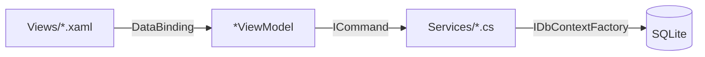

# 07. ViewModels — экраны, команды и жизненный цикл

> Этот файл описывает ViewModel-слой приложения AutoKassa. Все ViewModel находятся в [`AutoKassa/ViewModels`](../../AutoKassa/ViewModels). Машиночитаемый каталог: [`json/viewmodels.json`](json/viewmodels.json), граф зависимостей: [`json/relationships.json`](json/relationships.json).

---

## 1. Архитектурная основа MVVM

- **Model** — EF Core-сущности (`Transaction`, `Category`, `AppSettings` и др.).
- **ViewModel** — экранная логика, команды и свойства для привязки. Не зависят от View.
- **View** — XAML-разметка. Code-behind содержит только минимальную UI-логику.

Связь между слоями:

- `INotifyPropertyChanged`
- `ICommand` ([`RelayCommand`](../../AutoKassa/Helpers/RelayCommand.cs), [`AsyncRelayCommand`](../../AutoKassa/Helpers/AsyncRelayCommand.cs))
- `INotifyDataErrorInfo`
- `DataTemplate` в [`MainWindow.xaml`](../../AutoKassa/MainWindow.xaml) и [`ReportsView.xaml`](../../AutoKassa/Views/ReportsView.xaml)



---

## 2. Базовый класс `ViewModelBase`

Файл: [`AutoKassa/Helpers/ViewModelBase.cs`](../../AutoKassa/Helpers/ViewModelBase.cs)

Абстрактный базовый класс для всех ViewModel. Реализует:

- `INotifyPropertyChanged`
- `INotifyDataErrorInfo`
- `IDisposable`

### 2.1. Ключевые API

| Метод / свойство | Назначение |
|---|---|
| `SetProperty<T>(ref T, T, propertyName)` | Установка свойства с проверкой равенства и вызовом `PropertyChanged`. |
| `RunAsync(Func<Task>, onError)` | Fire-and-forget запуск асинхронной работы с логированием ошибок. |
| `SetErrors(propertyName, errors)` | Установка ошибок валидации для свойства. |
| `ClearErrors(propertyName)` | Очистка ошибок (или всех, если `null`). |
| `GetFirstError(propertyName)` | Первая ошибка для свойства. |
| `Dispose()` / `OnDispose()` | Освобождение ресурсов. |

---

## 3. Команды

### 3.1. `RelayCommand` / `RelayCommand<T>`

Файл: [`AutoKassa/Helpers/RelayCommand.cs`](../../AutoKassa/Helpers/RelayCommand.cs)

Синхронные реализации `ICommand`. Событие `CanExecuteChanged` маршрутизируется через `CommandManager.RequerySuggested`.

### 3.2. `AsyncRelayCommand` / `AsyncRelayCommand<T>`

Файл: [`AutoKassa/Helpers/AsyncRelayCommand.cs`](../../AutoKassa/Helpers/AsyncRelayCommand.cs)

Асинхронные команды с защитой от повторного входа (`_isExecuting`). Исключения логируются через Serilog.

---

## 4. Жизненный цикл ViewModel

### 4.1. Интерфейсы

- [`IAsyncInitializable`](../../AutoKassa/ViewModels/IAsyncInitializable.cs):
  ```csharp
  public interface IAsyncInitializable
  {
      bool IsInitialized { get; }
      Task InitializeAsync();
  }
  ```
- [`INavigationAware`](../../AutoKassa/Services/INavigationAware.cs):
  ```csharp
  public interface INavigationAware
  {
      void OnNavigatedTo();
      void OnNavigatedFrom();
  }
  ```

### 4.2. `NavigationService`

Файл: [`AutoKassa/Services/NavigationService.cs`](../../AutoKassa/Services/NavigationService.cs)

- DI-навигация: `NavigateTo<TViewModel>()` и `NavigateTo<TViewModel>(object parameter)`.
- Вызывает `OnNavigatedFrom` для старого VM и `OnNavigatedTo` для нового.
- Через reflection ищет метод `Initialize(object parameter)`.
- Вызывает `Dispose()` для уходящего VM, кроме page ViewModel с маркером `IPageViewModel` (вкладки главного окна — Singleton, живут всё время работы приложения; повторный заход на вкладку без изменений данных не перезагружает данные благодаря `_isInitialized`/`_needsRefresh`).

### 4.3. Асинхронная инициализация

- Все операции с БД выполняются асинхронно (`async/await`).
- `RunAsync` используется для fire-and-forget задач (загрузка данных, применение фильтров).
- `CancellationTokenSource` применяется для:
  - дебаунса поиска (`TransactionsViewModel`)
  - отмены устаревших запросов при быстрой смене фильтров
  - отмены при `Dispose()`

---

## 5. Валидация

- Реализована через `INotifyDataErrorInfo` в `ViewModelBase`.
- Ошибки устанавливаются вручную в сеттерах или командах (`SetErrors` / `ClearErrors`).
- Примеры: [`TransactionEditViewModel`](../../AutoKassa/ViewModels/TransactionEditViewModel.cs) проверяет сумму, категорию и дату; [`InitialSetupViewModel`](../../AutoKassa/ViewModels/InitialSetupViewModel.cs) использует `*Error`-свойства.

---

## 6. `IDataChangeService` и обновление экранов

Файл: [`AutoKassa/Services/IDataChangeService.cs`](../../AutoKassa/Services/IDataChangeService.cs)

- Центральный сервис рассылает событие `DataChanged`.
- ViewModel (`DashboardViewModel`, `TransactionsViewModel`, `ReportsViewModel`, `CategoriesViewModel`, `CounterpartiesViewModel`, `CreditCardsViewModel`) подписываются на него.
- При `OnNavigatedTo` проверяется флаг `_needsRefresh` и выполняется перезагрузка.

---

## 7. Модальные окна и диалоги

- Родительский VM открывает модал через `IsModalOpen = true` + дочерний VM (`*EditViewModel`).
- Дочерний VM сообщает о результате через callback: `OnSaved`, `OnCancelled`, `OnClosed`.
- Примеры:
  - [`TransactionEditViewModel`](../../AutoKassa/ViewModels/TransactionEditViewModel.cs) — добавление/редактирование операции.
  - [`DebtRepaymentViewModel`](../../AutoKassa/ViewModels/DebtRepaymentViewModel.cs) — погашение долга.
  - [`CreditCardRepaymentViewModel`](../../AutoKassa/ViewModels/CreditCardRepaymentViewModel.cs) — погашение кредитной карты.
  - [`CounterpartyEditViewModel`](../../AutoKassa/ViewModels/CounterpartyEditViewModel.cs) — редактирование контрагента.
  - [`CategoryManagerViewModel`](../../AutoKassa/ViewModels/CategoryManagerViewModel.cs) — управление категориями.

### 7.1. `ModalViewModel`

Файл: [`AutoKassa/ViewModels/Reports/ModalViewModel.cs`](../../AutoKassa/ViewModels/Reports/ModalViewModel.cs)

Упрощённый хост модального содержимого:

```csharp
public class ModalViewModel : ViewModelBase
{
    public bool IsOpen { get; set; }
    public ViewModelBase Content { get; set; }
    public void Show(ViewModelBase content);
    public void Close();
}
```

---

## 8. Оптимистичные обновления UI

- [`DashboardViewModel`](../../AutoKassa/ViewModels/DashboardViewModel.cs) и [`TransactionsViewModel`](../../AutoKassa/ViewModels/TransactionsViewModel.cs) добавляют/удаляют элементы в коллекциях до полной перезагрузки.
- Это уменьшает мерцание и ускоряет отклик.

---

## 9. Отчёты

### 9.1. `BaseReportViewModel`

Файл: [`AutoKassa/ViewModels/Reports/BaseReportViewModel.cs`](../../AutoKassa/ViewModels/Reports/BaseReportViewModel.cs)

Абстрактный базовый класс для всех отчётов:

- `IsLoading`, `HasData`
- `DateFrom`, `DateTo` (сеттер: `OnDateChangedByUser()` + `ValidateDateRange()` + `AutoRefresh()`), `ValidateDateRange()`
- `ActivePeriodPreset`, `SetPeriod(string)`, `SetPeriodCommand`
- `SelectedPaymentType` + `IsPaymentAll/Cash/NonCash/CreditCard`, команды `SetPaymentAll/Cash/NonCash/CreditCardCommand` (используются тремя отчётами; `DebtReportViewModel` их не биндит)
- `Modal` — для встроенного редактирования
- `GenerateCommand`, `ExportToPdfCommand`, `ExportToExcelCommand`
- `ShowExportedToast(filePath, formatName)` — общий тост «Отчёт сохранён» после экспорта
- `InitializeAsync()` → `GenerateReportAsync()`
- `AutoRefresh()` с дебаунсом через `DispatcherTimer`
- `BatchUpdate()` — подавление автоматического обновления при массовых изменениях
- Абстрактные: `LoadDataAsync()`, `ReportName`.
- `protected virtual`: `CheckHasData()`, `ExportToPdfAsync()`, `ExportToExcelAsync()`.

### 9.2. Конкретные отчёты

| ViewModel | Экран | Особенности |
|---|---|---|
| `BalanceReportViewModel` | Баланс | График OxyPlot: area income/expense, line balance. Фильтр по типу оплаты. |
| `CategoryReportViewModel` | Структура | Donut-график, разворачиваемые категории. |
| `TransactionDetailReportViewModel` | Детализация | Группировка по датам, фильтр по категории. |
| `DebtReportViewModel` | Долги | Фильтры направления/статуса, погашение из отчёта. |

### 9.3. Фабрика отчётов

```csharp
public interface IReportViewModelFactory
{
    BalanceReportViewModel CreateBalanceReportViewModel();
    CategoryReportViewModel CreateCategoryReportViewModel();
    TransactionDetailReportViewModel CreateTransactionDetailReportViewModel();
    DebtReportViewModel CreateDebtReportViewModel();
}
```

Реализация: [`AutoKassa/ViewModels/Reports/ReportViewModelFactory.cs`](../../AutoKassa/ViewModels/Reports/ReportViewModelFactory.cs).

---

## 10. Каталог ViewModel по экранам

| ViewModel | Файл | View | Экран | Ключевые команды |
|---|---|---|---|---|
| `MainWindowViewModel` | [`MainWindowViewModel.cs`](../../AutoKassa/ViewModels/MainWindowViewModel.cs) | [`MainWindow.xaml`](../../AutoKassa/MainWindow.xaml) | Главное окно | Навигация, блокировка |
| `DashboardViewModel` | [`DashboardViewModel.cs`](../../AutoKassa/ViewModels/DashboardViewModel.cs) | [`DashboardView.xaml`](../../AutoKassa/Views/DashboardView.xaml) | Дашборд | SelectPeriod, OpenAddTransaction, Refresh |
| `TransactionsViewModel` | [`TransactionsViewModel.cs`](../../AutoKassa/ViewModels/TransactionsViewModel.cs) | [`TransactionsView.xaml`](../../AutoKassa/Views/TransactionsView.xaml) | Операции | Load, ApplyFilters, Add, Edit, Delete |
| `ReportsViewModel` | [`ReportsViewModel.cs`](../../AutoKassa/ViewModels/ReportsViewModel.cs) | [`ReportsView.xaml`](../../AutoKassa/Views/ReportsView.xaml) | Отчёты | Переключение вкладок |
| `CategoriesViewModel` | [`CategoriesViewModel.cs`](../../AutoKassa/ViewModels/CategoriesViewModel.cs) | [`CategoriesView.xaml`](../../AutoKassa/Views/CategoriesView.xaml) | Категории | Load, OpenManager, Delete |
| `CategoryManagerViewModel` | [`CategoryManagerViewModel.cs`](../../AutoKassa/ViewModels/CategoryManagerViewModel.cs) | [`CategoryManagerView.xaml`](../../AutoKassa/Views/CategoryManagerView.xaml) | Менеджер категорий | AddIncome, AddExpense, Close |
| `CounterpartiesViewModel` | [`CounterpartiesViewModel.cs`](../../AutoKassa/ViewModels/CounterpartiesViewModel.cs) | [`CounterpartiesView.xaml`](../../AutoKassa/Views/CounterpartiesView.xaml) | Контрагенты | Add, Refresh, Filter, Delete |
| `CounterpartyEditViewModel` | [`CounterpartyEditViewModel.cs`](../../AutoKassa/ViewModels/CounterpartyEditViewModel.cs) | [`CounterpartyEditView.xaml`](../../AutoKassa/Views/CounterpartyEditView.xaml) | Редактор контрагента | Save, Cancel |
| `CreditCardsViewModel` | [`CreditCardsViewModel.cs`](../../AutoKassa/ViewModels/CreditCardsViewModel.cs) | [`CreditCardsView.xaml`](../../AutoKassa/Views/CreditCardsView.xaml) | Кредитные карты | Load, Add, Edit, Delete, Repay |
| `CreditCardEditViewModel` | [`CreditCardEditViewModel.cs`](../../AutoKassa/ViewModels/CreditCardEditViewModel.cs) | [`CreditCardEditView.xaml`](../../AutoKassa/Views/CreditCardEditView.xaml) | Редактор карты | Save, Cancel |
| `CreditCardRepaymentViewModel` | [`CreditCardRepaymentViewModel.cs`](../../AutoKassa/ViewModels/CreditCardRepaymentViewModel.cs) | [`CreditCardRepaymentView.xaml`](../../AutoKassa/Views/CreditCardRepaymentView.xaml) | Погашение карты | Repay, Cancel |
| `ReconciliationViewModel` | [`ReconciliationViewModel.cs`](../../AutoKassa/ViewModels/ReconciliationViewModel.cs) | [`ReconciliationView.xaml`](../../AutoKassa/Views/ReconciliationView.xaml) | Сверка кассы | Load, Export |
| `SettingsViewModel` | [`SettingsViewModel.cs`](../../AutoKassa/ViewModels/SettingsViewModel.cs) | [`SettingsView.xaml`](../../AutoKassa/Views/SettingsView.xaml) | Настройки | Save, Export, Import, Backup, ConnectYandex, ConfirmYandexCode, DisconnectYandex, UploadNow, DiscardPendingCopy |
| `InitialSetupViewModel` | [`InitialSetupViewModel.cs`](../../AutoKassa/ViewModels/InitialSetupViewModel.cs) | [`InitialSetupView.xaml`](../../AutoKassa/Views/InitialSetupView.xaml) | Первый запуск | Continue |
| `LockScreenViewModel` | [`LockScreenViewModel.cs`](../../AutoKassa/ViewModels/LockScreenViewModel.cs) | [`LockScreenView.xaml`](../../AutoKassa/Views/LockScreenView.xaml) | Блокировка | Unlock, ShowPasswordRecovery, CancelPasswordRecovery |
| `ChangePasswordViewModel` | [`ChangePasswordViewModel.cs`](../../AutoKassa/ViewModels/ChangePasswordViewModel.cs) | [`ChangePasswordView.xaml`](../../AutoKassa/Views/ChangePasswordView.xaml) | Смена пароля | Save, Cancel |
| `PasswordRecoveryViewModel` | [`PasswordRecoveryViewModel.cs`](../../AutoKassa/ViewModels/PasswordRecoveryViewModel.cs) | [`LockScreenView.xaml`](../../AutoKassa/Views/LockScreenView.xaml) | Восстановление пароля | VerifyAnswer, ResetPassword, Cancel |
| `TransactionEditViewModel` | [`TransactionEditViewModel.cs`](../../AutoKassa/ViewModels/TransactionEditViewModel.cs) | [`TransactionEditView.xaml`](../../AutoKassa/Views/TransactionEditView.xaml) | Редактор операции | Save, SaveAndAddNext, Cancel |
| `CalculatorViewModel` | [`CalculatorViewModel.cs`](../../AutoKassa/ViewModels/CalculatorViewModel.cs) | встроен в `TransactionEditView` | Калькулятор | Digit, Op, Equals, Clear |
| `DebtRepaymentViewModel` | [`DebtRepaymentViewModel.cs`](../../AutoKassa/ViewModels/DebtRepaymentViewModel.cs) | [`DebtRepaymentView.xaml`](../../AutoKassa/Views/DebtRepaymentView.xaml) | Погашение долга | Repay, Cancel |

> **Примечание по восстановлению пароля:** `PasswordRecoveryViewModel` зарегистрирован в DI как Transient и встроен в экран блокировки: `LockScreenViewModel` получает его через конструктор (свойство `Recovery`) и переключает панели по `IsPasswordRecoveryMode` (`ShowPasswordRecoveryCommand` / `CancelPasswordRecoveryCommand`; `CanUnlock()` дополнительно требует `!IsPasswordRecoveryMode`). Перед открытием панели вызывается `Recovery.Reset()` — очистка состояния и перезагрузка секретного вопроса. События `Recovery.OnPasswordReset` / `OnCancelled` возвращают к панели входа; `OnDispose()` отписывает и диспозит `Recovery`. В [`LockScreenView.xaml`](../../AutoKassa/Views/LockScreenView.xaml) — рабочая форма: секретный вопрос, ответ, новый пароль + подтверждение, биндинги через `Recovery.*`.
>
> **Связанные изменения автоблокировки:** `MainWindowViewModel.NotifyUserActivity()` — публичный метод с троттлингом 15 с (`ActivityResetInterval`), вызывается из `MainWindow.xaml.cs` (`InputManager.PreProcessInput`, только клавиатура/кнопки мыши) и сбрасывает таймер через `ILockService.ResetAutoLockTimer()` — таймер отсчитывает простой. `SettingsViewModel` получил зависимость `ILockService`: `SaveAsync` применяет настройки автоблокировки сразу (`StartAutoLockTimer`/`StopAutoLockTimer`), без перезапуска приложения. В ручных созданиях `SettingsViewModel` в тестах (`SettingsValidatorTests`, `SettingsMapperTests`) добавлен параметр `null!`.
>
> **Облачный регион «Яндекс Диск» (этапы 3–4 облачного бэкапа):** `SettingsViewModel` получил зависимости `IYandexDiskAuthService`, `IYandexDiskBackupService`, `IAutomaticBackupService`. Команды — `AsyncRelayCommand`: `ConnectYandexCommand` (старт OAuth; если ClientId не задан — сначала модальный оверлей ввода `YandexClientIdDialogViewModel` (`IsClientIdDialogOpen` + `ClientIdDialog` + DataTemplate в SettingsView, как редактор операции): значение сохраняется через `IYandexDiskClientIdStore` и подключение продолжается из колбэка `OnClose` без перезапуска; браузер открывает `YandexDiskAuthService`; сервис переходит в транзитное состояние `AwaitingCode`), `ConfirmYandexCodeCommand` (обмен одноразового кода; после успеха сбрасывает `YandexDiskLastBackupUtc` через `SetYandexDiskLastBackupUtcAsync(null)` и будит координатора `RequestCheck`; после неуспешного обмена сбрасывает `CloudAwaitingCode`/код — повторное подключение доступно без перезапуска, YD-03), `CancelYandexInputCommand` (отмена ожидания кода через `CancelAuthorizationAsync`), `DisconnectYandexCommand` (отключение + сброс даты), `UploadNowCommand` (`UploadNowAsync(force: true)`; успех — toast, ошибка — диалог с `CloudBackupState.UserMessage` без технических деталей), `DiscardPendingCopyCommand` (подтверждение через `ShowConfirmation` — удаляется только производный файл очереди, исходная БД не затрагивается; затем `DiscardPendingAndUploadAsync` — снятие постоянного 409 с чужим файлом, раздел 6 аудита), `CopyYandexAuthLinkCommand` (копирует `CloudAuthUrl` в буфер через `IClipboardService` — запасной путь, если браузер не открылся автоматически, YD-10). Свойства состояния применяются через единый `ApplyAuthState` (`YandexAuthState` + производный `CloudAwaitingCode`, TRAPS §3.21), состояние копии — через единый `ApplyCloudState` (уведомляет и о вычисляемом `CloudLastSuccessText`; при загрузке дата подставляется из настроек, при отключении индикатор очереди не гасится вручную — YD-11): `YandexDiskBackupEnabled` (через `SettingsMapper`), `YandexAuthState`, `CloudStatusMessage`, `CloudLastSuccessUtc`/`CloudLastSuccessText`, `CloudHasPendingFile`, `CloudIsBusy`, `CloudAwaitingCode`, `CloudAuthCode`, `CloudAuthUrl`, `CloudPendingFileText` (имя/дата/размер ожидающего файла из `CloudBackupState.PendingFile`), `CloudLastFailureText` (время последней неудачной попытки). События `StateChanged` облачных сервисов подписываются в конструкторе и маршалятся на захваченный UI `SynchronizationContext` (`SynchronizationContext.Current` на момент создания Singleton-VM); отписка — в `OnDispose()`. `SaveAsync` после успешного сохранения вызывает `IAutomaticBackupService.RequestCheck()`.

### 10.1. Вспомогательные VM-обёртки

- `SelectableTransaction` — добавляет `IsSelected` для массового выделения.
- `SelectableDateGroup` — группа дат с возможностью инлайн-добавления.
- `DateGroup` / `CategorySummaryItem` — read-only модели для дашборда.
- `CreditCardListItemViewModel` — элемент списка кредитных карт с метриками.
- `CategoryItemViewModel` — строка категории в менеджере.
- `CounterpartyViewModel` — строка контрагента.

---

## 11. Рекомендации по разработке ViewModel

1. Все VM наследуют `ViewModelBase`.
2. Асинхронные операции БД оборачивайте в `RunAsync` или `async Command`.
3. Используйте `CancellationToken` для отменяемых операций.
4. Валидация — через `SetErrors` / `ClearErrors`.
5. Подписывайтесь на `IDataChangeService` и сбрасывайте `_needsRefresh` в `OnNavigatedTo`.
6. Освобождайте ресурсы в `OnDispose()`.
7. Модальные диалоги открывайте через callback (`OnSaved` / `OnCancelled`), а не прямые ссылки на View.
