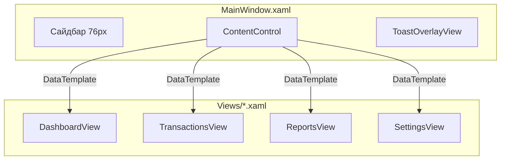

# 08. Views — XAML, стили и UI-компоненты

> Этот файл описывает XAML-слой AutoKassa: окна, представления, глобальные стили, конвертеры и пользовательские шаблоны. См. также [`07-viewmodels.md`](07-viewmodels.md) и [`json/relationships.json`](json/relationships.json).

---

## 1. Общая архитектура представлений

- [`MainWindow.xaml`](../../AutoKassa/MainWindow.xaml) — корневое безрамочное окно с сайдбаром и хостом контента.
- [`App.xaml`](../../AutoKassa/App.xaml) — глобальные ресурсы: кисти, конвертеры, стили элементов управления.
- Каждый экран приложения — `UserControl` в [`AutoKassa/Views`](../../AutoKassa/Views).
- Переключение экранов происходит через `DataTemplate` в `MainWindow.xaml` (по типу ViewModel).
- Code-behind View содержит только минимальную UI-логику.



---

## 2. `App.xaml` — глобальные ресурсы

Файл: [`AutoKassa/App.xaml`](../../AutoKassa/App.xaml)

### 2.1. Цветовая палитра

| Кисть | Назначение |
|---|---|
| `PrimaryBrush` | Основной акцент (синий). |
| `SidebarBrush` | Тёмный фон сайдбара `#1a1d23`. |
| `BackgroundBrush` / `ContentBgBrush` | Фон экранов. |
| `CardBgBrush` / `SurfaceBrush` | Фон карточек. |
| `AccentGreenBrush` / `SuccessBrush` | Доходы, успех. |
| `AccentRedBrush` / `ErrorBrush` | Расходы, ошибки. |
| `TextPrimaryBrush` / `MutedTextBrush` | Основной и второстепенный текст. |
| `BorderLightBrush` | Границы карточек и контролов. |

### 2.2. Глобальные стили

- `PillButton`, `PillButtonRed` — скруглённые основные кнопки.
- `ChipButton` — фильтры-«чипсы».
- `SummaryCard` — карточки показателей.
- `FloatingActionButton` — круглая кнопка действия.
- `PeriodPresetButtonStyle` — кнопки быстрого выбора периода.
- `ReportTabButtonStyle` — вкладки отчётов.
- `FlatListItem` — элементы плоских списков.
- Глобальные переопределения: `ComboBox`, `TextBox`, `DatePicker`, `Calendar`, `CheckBox`, `ScrollBar`, `ContextMenu`.

### 2.3. Конвертеры

Все конвертеры регистрируются в `App.xaml` и находятся в [`AutoKassa/Helpers/Converters`](../../AutoKassa/Helpers/Converters).

---

## 3. `MainWindow.xaml`

Файл: [`AutoKassa/MainWindow.xaml`](../../AutoKassa/MainWindow.xaml)

### 3.1. Ключевые элементы

- `WindowChrome` — кастомная рамка окна, высота заголовка 36px.
- Кастомные кнопки сворачивания, развёртывания, закрытия.
- Тёмный сайдбар шириной 76px с иконками.
- Кнопки навигации с горячими клавишами `Alt+1..7`.
- Кнопка блокировки `Ctrl+L`.
- `ContentControl` с `DataTemplate` для каждого top-level ViewModel.
- `ToastOverlayView` — поверх всех экранов.

---

## 4. Конвертеры

Файлы: [`AutoKassa/Helpers/Converters/*.cs`](../../AutoKassa/Helpers/Converters)

| Конвертер | Назначение |
|---|---|
| `BoolToVisibilityConverter` | `bool` / `null` → `Visible` / `Collapsed`. Поддерживает `Inverse`. |
| `InverseBoolConverter` | Логическое отрицание. |
| `DecimalToStringConverter` | `decimal` → формат `N2 ₽`. |
| `IntToStringConverter` | `int` ↔ `string`. |
| `IntEqualityConverter` | `int == parameter` (например, для вкладок). |
| `EqualityConverter` | Сравнение нескольких значений. |
| `StringToVisibilityConverter` | Непустая строка → `Visible`. |
| `IsNegativeConverter` | Число < 0 → `true`. |
| `OperationTypeToColorConverter` | `Income` → зелёный, `Expense` → красный. |
| `OperationTypeToTextConverter` | `Income` → «Доход», `Expense` → «Расход». |
| `PaymentTypeToIconConverter` | `PaymentType` → emoji-иконка. |
| `PaymentTypeToTextConverter` | `PaymentType` → русская метка. |
| `CategoryColorConverter` | HEX-строка → `SolidColorBrush` (с кешированием и `Freeze`). |
| `TransactionAmountConverter` | `(amount, type)` → «+/- ₽». |
| `TransactionDotColorConverter` | `(type, categoryColor)` → кисть точки. |
| `DebtStatusToTextConverter` | Статус долга → русская метка. |
| `DebtStatusToColorConverter` | Статус долга → цвет. |
| `CounterpartyTypeToTextConverter` | Тип контрагента → русская метка. |
| `MaxModalHeightConverter` | `ActualHeight` контейнера → максимальная высота модального окна (минус отступ из параметра, по умолчанию 48; минимум 320). |

---

## 5. Общие UI-паттерны

### 5.1. Модальное окно

Повторяющийся паттерн в `CategoriesView.xaml`, `CounterpartiesView.xaml`, `CreditCardsView.xaml`, `ReportsView.xaml`, `DashboardView.xaml`:

```xml
<Grid>
    <!-- Основной контент; при IsModalOpen отключается ввод (IsHitTestVisible=False) -->
    <Grid x:Name="MainContent">...</Grid>

    <!-- Затемнённый оверлей -->
    <Grid Visibility="{Binding IsModalOpen, Converter={StaticResource BoolToVisibilityConverter}}">
        <Rectangle Fill="#66000000"/>
        <Border Background="White" CornerRadius="20">
            <!-- View модалки инстанцируется лениво: ContentControl + DataTemplate,
                 VM создаётся только при открытии и освобождается при закрытии -->
            <ContentControl Content="{Binding *EditViewModel}"/>
        </Border>
    </Grid>
</Grid>
```

Модальные окна инстанцируются лениво через `ContentControl Content="{Binding ...ViewModel}"` + типизированный `DataTemplate` (эталон — `ReportsView.xaml`): View не строится, пока VM модалки `null`. Blur-эффекты не используются (дорогой софтверный рендер на слабых GPU) — только затемняющий `Rectangle`.

Высота модалок адаптивная: внешний контейнер привязывает `MaxHeight` к `ActualHeight` UserControl через `MaxModalHeightConverter` (`DashboardView.xaml`, `TransactionsView.xaml`, `ReportsView.xaml`), а внутренний `Border` контента ограничен прежними `MaxHeight=775` (дашборд, операции) / `750` (отчёты). При больших окнах вид не изменился, при маленьких модалка не обрезается, а контент скроллится (`ScrollViewer` внутри `TransactionEditView`).

### 5.2. Период-пикер

Всплывающий `Popup` с пресетами (Сегодня, Неделя, Месяц, Год) и произвольным диапазоном `DatePicker`. Используется на дашборде и в операциях.

### 5.3. Фильтры-чипсы

Горизонтальные группы кнопок с `DataTrigger` для подсветки активного состояния. Применяются для:

- типа операции (Все / Доходы / Расходы)
- типа оплаты (Все / Нал / Безнал / Кредит)
- типа контрагента
- статуса долга

### 5.4. Summary Card

Карточки сводных показателей (`SummaryCard`) используются на `DashboardView`, `CreditCardsView`, `BalanceReportView`.

### 5.5. Floating Action Button (FAB)

Кнопка быстрого действия в правом нижнем углу экрана операций.

---

## 6. Пользовательские шаблоны элементов управления

### 6.1. `DatePicker` и `Calendar`

- Полностью переопределён шаблон `DatePicker`.
- Убрана стандартная иконка календаря.
- Скруглённые границы, единая цветовая схема.

### 6.2. `ComboBox`

- Глобальный стиль для `ComboBox` — скруглённые границы, тень у выпадающего списка.
- В `TransactionEditView.xaml` — отдельный `CreditCardComboBoxStyle`.
- В `TransactionsView.xaml` — компактный `InlineComboBoxStyle` для фильтра категории.

### 6.3. `CheckBox`

- `SelectionCheckBoxStyle` — квадратный чекбокс 18×18px с зелёной галочкой.
- `GreenCheckBoxStyle` — зелёный чекбокс настроек.

### 6.4. `ScrollBar`

- `ThinVerticalScrollBar` — узкий скроллбар 6px для модальных окон.

### 6.5. `ContextMenu`

- `ModernContextMenuStyle` — скруглённое белое меню с тенью.
- `MenuItemStyle` / `DeleteMenuItemStyle` — пункты с иконками.

---

## 7. Каталог Views

| View | Файл | Назначение |
|---|---|---|
| `MainWindow` | [`MainWindow.xaml`](../../AutoKassa/MainWindow.xaml) | Корневое окно, сайдбар, хост. |
| `DashboardView` | [`DashboardView.xaml`](../../AutoKassa/Views/DashboardView.xaml) | Дашборд, сводка, графики, список операций. |
| `TransactionsView` | [`TransactionsView.xaml`](../../AutoKassa/Views/TransactionsView.xaml) | Список операций, фильтры, инлайн-добавление, массовый выбор. |
| `ReportsView` | [`ReportsView.xaml`](../../AutoKassa/Views/ReportsView.xaml) | Хост отчётов с вкладками и модальным оверлеем. |
| `CategoriesView` | [`CategoriesView.xaml`](../../AutoKassa/Views/CategoriesView.xaml) | Каталог категорий с фильтрами и модальным менеджером. |
| `CategoryManagerView` | [`CategoryManagerView.xaml`](../../AutoKassa/Views/CategoryManagerView.xaml) | Редактор категорий с drag-and-drop и выбором цвета. |
| `CounterpartiesView` | [`CounterpartiesView.xaml`](../../AutoKassa/Views/CounterpartiesView.xaml) | Справочник контрагентов. |
| `CounterpartyEditView` | [`CounterpartyEditView.xaml`](../../AutoKassa/Views/CounterpartyEditView.xaml) | Форма контрагента. |
| `CreditCardsView` | [`CreditCardsView.xaml`](../../AutoKassa/Views/CreditCardsView.xaml) | Список карт, метрики, история покупок. |
| `CreditCardEditView` | [`CreditCardEditView.xaml`](../../AutoKassa/Views/CreditCardEditView.xaml) | Форма кредитной карты. |
| `CreditCardRepaymentView` | [`CreditCardRepaymentView.xaml`](../../AutoKassa/Views/CreditCardRepaymentView.xaml) | Погашение кредитки. |
| `SettingsView` | [`SettingsView.xaml`](../../AutoKassa/Views/SettingsView.xaml) | Настройки с боковыми вкладками. |
| `InitialSetupView` | [`InitialSetupView.xaml`](../../AutoKassa/Views/InitialSetupView.xaml) | Первичная настройка пароля. |
| `LockScreenView` | [`LockScreenView.xaml`](../../AutoKassa/Views/LockScreenView.xaml) | Экран блокировки. |
| `TransactionEditView` | [`TransactionEditView.xaml`](../../AutoKassa/Views/TransactionEditView.xaml) | Диалог операции с калькулятором. |
| `DebtRepaymentView` | [`DebtRepaymentView.xaml`](../../AutoKassa/Views/DebtRepaymentView.xaml) | Погашение долга. |
| `ToastOverlayView` | [`ToastOverlayView.xaml`](../../AutoKassa/Views/ToastOverlayView.xaml) | Toast-уведомления. |
| `BalanceReportView` | [`Reports/BalanceReportView.xaml`](../../AutoKassa/Views/Reports/BalanceReportView.xaml) | Отчёт баланса с OxyPlot. |
| `CategoryReportView` | [`Reports/CategoryReportView.xaml`](../../AutoKassa/Views/Reports/CategoryReportView.xaml) | Отчёт по категориям. |
| `TransactionDetailReportView` | [`Reports/TransactionDetailReportView.xaml`](../../AutoKassa/Views/Reports/TransactionDetailReportView.xaml) | Детализация операций. |
| `DebtReportView` | [`Reports/DebtReportView.xaml`](../../AutoKassa/Views/Reports/DebtReportView.xaml) | Отчёт по долгам. |

---

## 8. Ключевые особенности отдельных Views

### 8.1. `DashboardView.xaml`

- Summary cards: Баланс, Доходы, Расходы, Прибыль периода.
- Period picker popup.
- Группированный список операций по дням.
- Правый столбец: виджет кредитной карты, топ расходов, топ доходов.
- Hotkeys: `Ctrl+N`, `F2`, `Delete`, `F5`.

### 8.2. `TransactionsView.xaml`

- Горизонтальная панель фильтров с поиском, периодом, чипсами.
- `ListBox` с группировкой операций по датам (DataGrid в проекте не используется).
- Бесконечный скролл: code-behind находит внутренний `ScrollViewer` списка (`VisualTreeHelper`, первый `ScrollViewer` дерева; подписка в `Loaded`, отписка в `Unloaded`) и при приближении к низу (порог 200px, константа `LoadMoreThreshold`) вызывает `TransactionsViewModel.LoadMoreCommand` с проверкой `CanExecute` — подгружаются следующие страницы по 100 записей.
- Inline-форма добавления/редактирования операции внутри группы; визуальное дерево формы строится лениво (ContentControl + DataTemplate) только для группы с открытым редактором.
- CheckBox для массового выделения.
- Контекстное меню с редактированием/удалением.

### 8.3. `TransactionEditView.xaml`

- Переключатель типа Расход / Доход.
- Большое поле суммы с калькулятором.
- Выбор кассы: Наличные / Безналичные / Кредитка / Долг.
- Сетка категорий-чипсов.
- ComboBox кредитных карт, контрагентов.
- Hotkeys: `Ctrl+Enter` — сохранить, `Shift+Enter` — сохранить и добавить следующую, `Esc` — отмена.

### 8.4. `CategoryManagerView.xaml`

- Drag-and-drop сортировка категорий (code-behind обработчики).
- Popup выбора цвета из `PresetColors`.
- Inline-переименование через `TextBox`/`TextBlock`.

### 8.5. `SettingsView.xaml`

- Боковое меню настроек через `RadioButton` + `IntEqualityConverter`.
- 7 вкладок: Общие, Операции, Отчёты, Резервное копирование, Безопасность, Кредитная карта, О программе.
- Карточки секций через `SettingsSectionCard`.
- Из UI удалены три неработающих чекбокса: «Показывать уведомления» (`ShowNotifications`), «Показывать "Категории" в меню» (`ShowOperationsInSidebar`), «Подтверждать удаление» (`ConfirmDelete`). Свойства в `SettingsViewModel`/`SettingsMapper`/`AppSettings` и поля в БД сохранены — удалён только UI.

### 8.6. `ReportsView.xaml`

- Tab bar для четырёх отчётов.
- `ContentControl` с `DataTemplate` для каждого report VM.
- Модальный оверлей для `TransactionEditViewModel` и `DebtRepaymentViewModel`.

### 8.7. `ToastOverlayView.xaml`

- Нижнее центрированное уведомление.
- Иконки: удаление, успех, ошибка, информация.
- Кнопки действия и «Отменить».
- Полоса обратного отсчёта через `ScaleTransform`.
- Время жизни toast — 4 секунды (`TotalTicks=100` × `TickIntervalMs=40` в code-behind): кнопка «Отменить» (undo удаления) успевает быть нажатой.

### 8.8. `InitialSetupView.xaml` / `LockScreenView.xaml`

- Отдельные `Window` (не `UserControl`).
- `PasswordBox` с code-behind обработчиками `PasswordChanged`.
- `LockScreenView` — `Topmost`, без рамки, с кнопкой закрытия приложения.
- `LockScreenView` содержит две панели: вход (пароль) и восстановление пароля (секретный вопрос, ответ, новый пароль + подтверждение, кнопки «Проверить»/«Сменить пароль»/«Назад»; биндинги через `Recovery.*`). Переключение по `IsPasswordRecoveryMode`; в code-behind — `PasswordChanged`-обработчики, Enter на панели, очистка полей и фокус при переключении. Закрытие окна без разблокировки завершает приложение (см. `LockService.Lock()`).

---

## 9. Code-behind: что допустимо

Согласно архитектуре MVVM в проекте:

- **Разрешено:** обработчики ввода для `PasswordBox`, drag-and-drop категорий, клики по кнопкам тайтлбара, code-behind графиков OxyPlot.
- **Запрещено:** бизнес-логика, прямое обращение к сервисам, навигация.

---

## 10. Рекомендации по разработке Views

1. Используйте существующие кисти и стили из `App.xaml`.
2. Для нового экрана создайте `UserControl`, добавьте `DataTemplate` в `MainWindow.xaml`.
3. Для модальных диалогов используйте паттерн `IsModalOpen` + `*EditViewModel`.
4. Конвертеры регистрируйте в `App.xaml`, а сам класс размещайте в `Helpers/Converters`.
5. Старайтесь не дублировать стили — выносите повторяющиеся в `App.xaml` или `UserControl.Resources`.
6. Сохраняйте code-behind минимальным.
