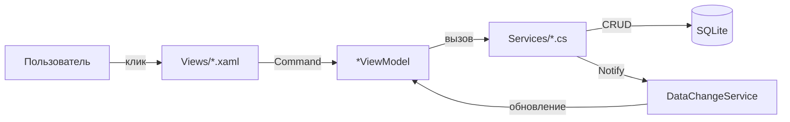

# 09. Пользовательские сценарии (flows)

> Этот файл описывает типичные end-to-end сценарии использования AutoKassa. Машиночитаемая версия с полным списком шагов: [`json/flows.json`](json/flows.json).

---

## 1. Запуск приложения

**Триггер:** пользователь запускает `AutoKassa.exe`.

| Шаг | Actor | Действие | Файл/метод | Примечания |
|-----|-------|----------|------------|------------|
| 1 | UI | Запуск WPF | [`App.xaml.cs`](../../AutoKassa/App.xaml.cs) `OnStartup` | Настройка Serilog, глобальные обработчики исключений. |
| 2 | Service | Конфигурация DI | [`App.xaml.cs`](../../AutoKassa/App.xaml.cs) `ConfigureServices` | Регистрация DbContext, сервисов, фабрик, VM, MainWindow. |
| 3 | Service | Инициализация БД и настроек | [`App.xaml.cs`](../../AutoKassa/App.xaml.cs) `InitializeAsync` | Синхронно через `Task.Run(...).GetAwaiter().GetResult()`. |
| 4 | Service | Миграции + WAL | [`SettingsService.cs`](../../AutoKassa/Services/SettingsService.cs) `MigrateAsync` | EF Core миграции + `PRAGMA journal_mode=WAL`. |
| 5 | Service | Проверка пароля | [`SettingsService.cs`](../../AutoKassa/Services/SettingsService.cs) `IsPasswordSet` | Если `PasswordHash` пуст — первый запуск. |
| 6 | VM | Первоначальная настройка | [`InitialSetupViewModel.cs`](../../AutoKassa/ViewModels/InitialSetupViewModel.cs) `ContinueAsync` | Пароль + секретный вопрос + ответ. |
| 7 | Service | Сохранение пароля | [`SettingsService.cs`](../../AutoKassa/Services/SettingsService.cs) `SetPasswordAsync` | Сохраняет хеши пароля и ответа. |
| 8 | UI | Открытие главного окна | [`App.xaml.cs`](../../AutoKassa/App.xaml.cs) `OnStartup` | `MainWindow` через DI. |
| 9 | VM | Инициализация главного окна | [`MainWindowViewModel.cs`](../../AutoKassa/ViewModels/MainWindowViewModel.cs) ctor | Загрузка настроек, навигация на Dashboard, запуск автоблокировки. |

---

## 2. Добавление операции

### 2.1. С дашборда

**Триггер:** пользователь нажимает кнопку «+» на главном экране.

| Шаг | Actor | Действие | Файл/метод |
|-----|-------|----------|------------|
| 1 | User | Нажатие кнопки добавления | [`DashboardView.xaml`](../../AutoKassa/Views/DashboardView.xaml) |
| 2 | VM | Открытие формы | [`DashboardViewModel.cs`](../../AutoKassa/ViewModels/DashboardViewModel.cs) `OpenAddTransaction` |
| 3 | Service | Фабрика создаёт VM | [`TransactionEditViewModelFactory.cs`](../../AutoKassa/Services/Transactions/TransactionEditViewModelFactory.cs) `CreateForAdd` |
| 4 | VM | Инициализация полей | [`TransactionEditViewModel.cs`](../../AutoKassa/ViewModels/TransactionEditViewModel.cs) `InitializeForAdd` |
| 5 | VM | Загрузка справочников | `LoadCategoriesAsync`, `LoadCreditCardsAsync`, `LoadCounterpartiesAsync` |
| 6 | User | Заполнение полей | [`TransactionEditView.xaml`](../../AutoKassa/Views/TransactionEditView.xaml) |
| 7 | VM | Валидация | [`TransactionEditViewModel.cs`](../../AutoKassa/ViewModels/TransactionEditViewModel.cs) `SaveAsync` |
| 8 | VM | Вызов сервиса | [`TransactionEditViewModel.cs`](../../AutoKassa/ViewModels/TransactionEditViewModel.cs) `SaveAsync` |
| 9 | Service | Сохранение в БД | [`TransactionService.cs`](../../AutoKassa/Services/TransactionService.cs) `AddAsync` |
| 10 | Service | Уведомление | [`IDataChangeService.cs`](../../AutoKassa/Services/IDataChangeService.cs) `NotifyDataChanged` |
| 11 | VM | Оптимистичное обновление | [`DashboardViewModel.cs`](../../AutoKassa/ViewModels/DashboardViewModel.cs) `ApplyOptimisticAdd` |
| 12 | VM | Полная перезагрузка | `LoadDataAsync` |

### 2.2. Из экрана операций

**Триггер:** кнопка «Добавить» или Floating Action Button на экране операций.

| Шаг | Actor | Действие | Файл/метод |
|-----|-------|----------|------------|
| 1 | User | Нажатие кнопки | [`TransactionsView.xaml`](../../AutoKassa/Views/TransactionsView.xaml) |
| 2 | VM | Открытие формы | [`TransactionsViewModel.cs`](../../AutoKassa/ViewModels/TransactionsViewModel.cs) `AddTransaction` |
| 3 | Service | Фабрика создаёт VM | [`TransactionEditViewModelFactory.cs`](../../AutoKassa/Services/Transactions/TransactionEditViewModelFactory.cs) `CreateForAdd` |
| 4 | VM | Сохранение | [`TransactionEditViewModel.cs`](../../AutoKassa/ViewModels/TransactionEditViewModel.cs) `SaveAsync` |
| 5 | Service | Сохранение в БД | [`TransactionService.cs`](../../AutoKassa/Services/TransactionService.cs) `AddAsync` |
| 6 | VM | Обновление списка | [`TransactionsViewModel.cs`](../../AutoKassa/ViewModels/TransactionsViewModel.cs) `RefreshGroupsAsync` |

---

## 3. Погашение кредитной карты

**Триггер:** пользователь выбирает карту и нажимает «Погасить».

| Шаг | Actor | Действие | Файл/метод |
|-----|-------|----------|------------|
| 1 | User | Выбор карты | [`CreditCardsView.xaml`](../../AutoKassa/Views/CreditCardsView.xaml) |
| 2 | User | Нажатие «Погасить» | [`CreditCardsView.xaml`](../../AutoKassa/Views/CreditCardsView.xaml) |
| 3 | VM | Открытие формы | [`CreditCardsViewModel.cs`](../../AutoKassa/ViewModels/CreditCardsViewModel.cs) `OpenRepayCard` |
| 4 | VM | Инициализация | [`CreditCardRepaymentViewModel.cs`](../../AutoKassa/ViewModels/CreditCardRepaymentViewModel.cs) `InitializeAsync` |
| 5 | User | Ввод суммы, типа оплаты, даты | [`CreditCardRepaymentView.xaml`](../../AutoKassa/Views/CreditCardRepaymentView.xaml) |
| 6 | VM | Валидация | [`CreditCardRepaymentViewModel.cs`](../../AutoKassa/ViewModels/CreditCardRepaymentViewModel.cs) `RepayAsync` |
| 7 | Service | Создание операции-погашения | [`CreditCardService.cs`](../../AutoKassa/Services/CreditCardService.cs) `RepayDebtAsync` |
| 8 | Service | Распределение FIFO | [`CreditCardOperationHelper.cs`](../../AutoKassa/Services/CreditCardOperationHelper.cs) `DistributeRepaymentAsync` |
| 9 | Service | Сохранение | [`CreditCardService.cs`](../../AutoKassa/Services/CreditCardService.cs) `RepayDebtAsync` |
| 10 | VM | Обновление UI | OnSaved callback |

---

## 4. Работа с долгами

### 4.1. Создание долга

**Триггер:** добавление операции с `PaymentType = Debt`.

| Шаг | Actor | Действие | Файл/метод |
|-----|-------|----------|------------|
| 1 | User | Выбор «Долг» в форме операции | [`TransactionEditView.xaml`](../../AutoKassa/Views/TransactionEditView.xaml) |
| 2 | User | Выбор контрагента | [`TransactionEditView.xaml`](../../AutoKassa/Views/TransactionEditView.xaml) |
| 3 | VM | Валидация | [`TransactionEditViewModel.cs`](../../AutoKassa/ViewModels/TransactionEditViewModel.cs) `SaveAsync` |
| 4 | Service | Сохранение | [`TransactionService.cs`](../../AutoKassa/Services/TransactionService.cs) `AddAsync` |
| 5 | Service | Установка статуса | `DebtStatus.Active` |

### 4.2. Погашение долга

**Триггер:** кнопка «Погасить» в отчёте по долгам или на экране контрагентов.

| Шаг | Actor | Действие | Файл/метод |
|-----|-------|----------|------------|
| 1 | User | Нажатие «Погасить» | [`DebtReportView.xaml`](../../AutoKassa/Views/Reports/DebtReportView.xaml) |
| 2 | VM | Открытие формы | [`DebtReportViewModel.cs`](../../AutoKassa/ViewModels/Reports/DebtReportViewModel.cs) |
| 3 | VM | Инициализация | [`DebtRepaymentViewModel.cs`](../../AutoKassa/ViewModels/DebtRepaymentViewModel.cs) |
| 4 | User | Ввод суммы и типа оплаты | [`DebtRepaymentView.xaml`](../../AutoKassa/Views/DebtRepaymentView.xaml) |
| 5 | VM | Валидация | [`DebtRepaymentViewModel.cs`](../../AutoKassa/ViewModels/DebtRepaymentViewModel.cs) `RepayAsync` |
| 6 | Service | Создание погашения | [`DebtService.cs`](../../AutoKassa/Services/DebtService.cs) `RepayAsync` |
| 7 | Service | Запись DebtPayment | [`DebtService.cs`](../../AutoKassa/Services/DebtService.cs) `RepayAsync` |
| 8 | Service | Пересчёт статуса | [`DebtService.cs`](../../AutoKassa/Services/DebtService.cs) `RepayAsync` |
| 9 | VM | Обновление UI | OnSaved callback |

---

## 5. Формирование и экспорт отчёта

**Триггер:** пользователь переходит в «Отчёты» и выбирает период.

| Шаг | Actor | Действие | Файл/метод |
|-----|-------|----------|------------|
| 1 | User | Переход в «Отчёты» | [`MainWindowViewModel.cs`](../../AutoKassa/ViewModels/MainWindowViewModel.cs) `NavigateToReportsCommand` |
| 2 | User | Выбор отчёта | [`ReportsView.xaml`](../../AutoKassa/Views/ReportsView.xaml) |
| 3 | VM | Выбор периода | [`BalanceReportViewModel.cs`](../../AutoKassa/ViewModels/Reports/BalanceReportViewModel.cs) `GenerateCommand` |
| 4 | Service | Формирование | [`ReportService.cs`](../../AutoKassa/Services/ReportService.cs) `GenerateBalanceReportAsync` |
| 5 | Service | Данные по картам | [`CreditCardService.cs`](../../AutoKassa/Services/CreditCardService.cs) `GetTotalDebtAsync` |
| 6 | VM | Отображение | [`BalanceReportViewModel.cs`](../../AutoKassa/ViewModels/Reports/BalanceReportViewModel.cs) `ApplyReport`, `UpdateChart` |
| 7 | User | Экспорт PDF/Excel | `ExportToPdfCommand` / `ExportToExcelCommand` |
| 8 | Service | PDF | [`ExportService.cs`](../../AutoKassa/Services/ExportService.cs) `ExportBalanceReportToPdfAsync` |
| 9 | Service | Excel | [`ExportService.cs`](../../AutoKassa/Services/ExportService.cs) `ExportBalanceReportToExcelAsync` |
| 10 | Helper | Открытие файла | `FileLauncher.OpenExportedFile` |

---

## 6. Смена настроек и резервное копирование

**Триггер:** пользователь открывает «Настройки».

| Шаг | Actor | Действие | Файл/метод |
|-----|-------|----------|------------|
| 1 | User | Открытие настроек | [`MainWindowViewModel.cs`](../../AutoKassa/ViewModels/MainWindowViewModel.cs) `NavigateToSettingsCommand` |
| 2 | VM | Загрузка | [`SettingsViewModel.cs`](../../AutoKassa/ViewModels/SettingsViewModel.cs) `LoadSettingsAsync` |
| 3 | User | Изменение параметров | [`SettingsView.xaml`](../../AutoKassa/Views/SettingsView.xaml) |
| 4 | VM | Валидация | [`SettingsValidator.cs`](../../AutoKassa/Services/Settings/SettingsValidator.cs) `Validate` |
| 5 | VM | Сохранение | [`SettingsViewModel.cs`](../../AutoKassa/ViewModels/SettingsViewModel.cs) `SaveAsync` |
| 6 | Service | Синхронизация кредитки | [`CreditCardSettingsService.cs`](../../AutoKassa/Services/CreditCards/CreditCardSettingsService.cs) `SyncFromSettingsAsync` |
| 7 | Service | Уведомление | [`IDataChangeService.cs`](../../AutoKassa/Services/IDataChangeService.cs) `NotifyDataChanged` |
| 8 | User | Создание бэкапа | [`SettingsViewModel.cs`](../../AutoKassa/ViewModels/SettingsViewModel.cs) `CreateBackupCommand` |
| 9 | Service | Копирование БД | [`BackupCoordinator.cs`](../../AutoKassa/Services/Backup/BackupCoordinator.cs) → [`SettingsService.cs`](../../AutoKassa/Services/SettingsService.cs) `CreateBackupAsync` |
| 10 | User | Восстановление | [`SettingsViewModel.cs`](../../AutoKassa/ViewModels/SettingsViewModel.cs) `RestoreBackupCommand` |
| 11 | Service | Замена БД | [`BackupCoordinator.cs`](../../AutoKassa/Services/Backup/BackupCoordinator.cs) → [`SettingsService.cs`](../../AutoKassa/Services/SettingsService.cs) `RestoreBackupAsync` |

---

## 7. Автоблокировка и восстановление пароля

**Триггер:** таймаут неактивности или нажатие `Ctrl+L`.

> **Примечание:** `PasswordRecoveryViewModel` зарегистрирован, но **не используется**. В [`LockScreenView.xaml`](../../AutoKassa/Views/LockScreenView.xaml) восстановление пароля реализовано в виде заглушки с сообщением «Функция восстановления будет реализована позже».

| Шаг | Actor | Действие | Файл/метод |
|-----|-------|----------|------------|
| 1 | VM | Запуск таймера | [`MainWindowViewModel.cs`](../../AutoKassa/ViewModels/MainWindowViewModel.cs) ctor |
| 2 | Service | Настройка таймера | [`LockService.cs`](../../AutoKassa/Services/LockService.cs) `StartAutoLockTimer` |
| 3 | Service | Срабатывание | [`LockService.cs`](../../AutoKassa/Services/LockService.cs) `AutoLockTimer_Tick` |
| 4 | Service | Блокировка | [`LockService.cs`](../../AutoKassa/Services/LockService.cs) `Lock` |
| 5 | User | Ввод пароля | [`LockScreenView.xaml`](../../AutoKassa/Views/LockScreenView.xaml) |
| 6 | VM | Проверка | [`LockScreenViewModel.cs`](../../AutoKassa/ViewModels/LockScreenViewModel.cs) `Unlock` |
| 7 | Service | Верификация | [`PasswordService.cs`](../../AutoKassa/Services/PasswordService.cs) `VerifyPassword` |
| 8 | Service | Сброс таймера | [`LockService.cs`](../../AutoKassa/Services/LockService.cs) `ResetAutoLockTimer` |
| 9 | User | «Забыли пароль?» | [`LockScreenViewModel.cs`](../../AutoKassa/ViewModels/LockScreenViewModel.cs) `ShowPasswordRecoveryCommand` |
| 10 | VM | Форма восстановления | [`PasswordRecoveryViewModel.cs`](../../AutoKassa/ViewModels/PasswordRecoveryViewModel.cs) `LoadSecurityQuestion` |
| 11 | User | Ввод ответа | [`LockScreenView.xaml`](../../AutoKassa/Views/LockScreenView.xaml) |
| 12 | VM | Проверка ответа | [`PasswordRecoveryViewModel.cs`](../../AutoKassa/ViewModels/PasswordRecoveryViewModel.cs) `VerifyAnswerAsync` |
| 13 | User | Новый пароль | [`LockScreenView.xaml`](../../AutoKassa/Views/LockScreenView.xaml) |
| 14 | VM | Сброс | [`PasswordRecoveryViewModel.cs`](../../AutoKassa/ViewModels/PasswordRecoveryViewModel.cs) `ResetPasswordAsync` |
| 15 | Service | Сохранение | [`SettingsService.cs`](../../AutoKassa/Services/SettingsService.cs) `UpdatePasswordAsync` |

---

## 8. Удаление операции с undo

**Триггер:** пользователь нажимает «Удалить» в списке операций.

| Шаг | Actor | Действие | Файл/метод |
|-----|-------|----------|------------|
| 1 | User | Нажатие «Удалить» | [`DashboardView.xaml`](../../AutoKassa/Views/DashboardView.xaml) / [`TransactionsView.xaml`](../../AutoKassa/Views/TransactionsView.xaml) |
| 2 | VM | Вызов координатора | [`DashboardViewModel.cs`](../../AutoKassa/ViewModels/DashboardViewModel.cs) `DeleteTransactionAsync` |
| 3 | Service | Soft delete | [`TransactionService.cs`](../../AutoKassa/Services/TransactionService.cs) `DeleteAsync` |
| 4 | Service | Toast с отменой | [`ToastNotificationService.cs`](../../AutoKassa/Services/ToastNotificationService.cs) `ShowDeleteWithUndo` |
| 5 | VM | Обновление UI | Удаление из списка |
| 6 | User | «Отменить» | [`ToastOverlayView.xaml`](../../AutoKassa/Views/ToastOverlayView.xaml) |
| 7 | Service | Восстановление | [`TransactionService.cs`](../../AutoKassa/Services/TransactionService.cs) `RestoreAsync` |
| 8 | VM | Перезагрузка | `LoadDataAsync` |

---

## 9. Сводная схема потоков

