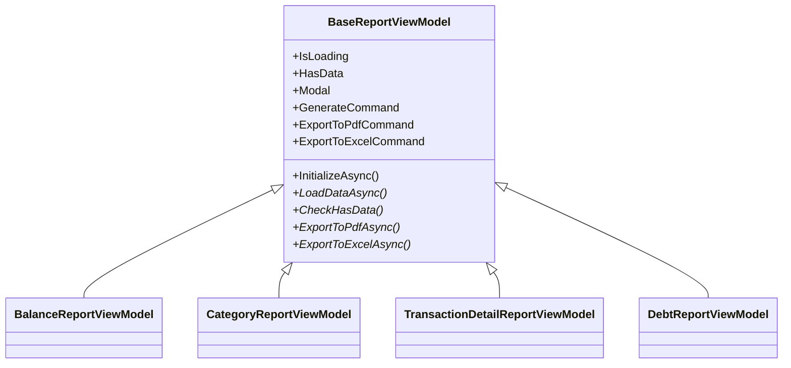

# 10. Отчёты и экспорт

> Этот файл описывает отчётную подсистему AutoKassa: виды отчётов, иерархию ViewModel, формирование данных и экспорт в PDF/Excel.

---

## 1. Виды отчётов

| Отчёт | Метод `IReportService` | DTO | VM | View | Назначение |
|-------|------------------------|-----|-----|------|------------|
| Баланс за период | `GenerateBalanceReportAsync` | [`BalanceReport.cs`](../../AutoKassa/Models/Reports/BalanceReport.cs) | [`BalanceReportViewModel.cs`](../../AutoKassa/ViewModels/Reports/BalanceReportViewModel.cs) | [`BalanceReportView.xaml`](../../AutoKassa/Views/Reports/BalanceReportView.xaml) | Доходы/расходы, остатки, график |
| Структура по категориям | `GenerateCategoryReportAsync` | [`CategoryReport.cs`](../../AutoKassa/Models/Reports/CategoryReport.cs) | [`CategoryReportViewModel.cs`](../../AutoKassa/ViewModels/Reports/CategoryReportViewModel.cs) | [`CategoryReportView.xaml`](../../AutoKassa/Views/Reports/CategoryReportView.xaml) | Donut-диаграмма, детализация |
| Детализация операций | `GenerateTransactionDetailReportAsync` | [`TransactionDetailReport.cs`](../../AutoKassa/Models/Reports/TransactionDetailReport.cs) | [`TransactionDetailReportViewModel.cs`](../../AutoKassa/ViewModels/Reports/TransactionDetailReportViewModel.cs) | [`TransactionDetailReportView.xaml`](../../AutoKassa/Views/Reports/TransactionDetailReportView.xaml) | Список операций с фильтрами |
| Долги | `GenerateDebtReportAsync` | [`DebtReport.cs`](../../AutoKassa/Models/Reports/DebtReport.cs) | [`DebtReportViewModel.cs`](../../AutoKassa/ViewModels/Reports/DebtReportViewModel.cs) | [`DebtReportView.xaml`](../../AutoKassa/Views/Reports/DebtReportView.xaml) | Дебиторка/кредиторка |
| Сверка кассы | `GetReconciliationDataAsync` | [`ReconciliationData.cs`](../../AutoKassa/Models/Reports/ReconciliationData.cs) | [`ReconciliationViewModel.cs`](../../AutoKassa/ViewModels/ReconciliationViewModel.cs) | [`ReconciliationView.xaml`](../../AutoKassa/Views/ReconciliationView.xaml) | Остатки нал/безнал на дату |

---

## 2. `ReportService`

**Файл:** [`AutoKassa/Services/ReportService.cs`](../../AutoKassa/Services/ReportService.cs)

**Интерфейс:** [`IReportService.cs`](../../AutoKassa/Services/IReportService.cs)

**Lifetime:** Transient

**Зависимости:**
- `IDbContextFactory<AppDbContext>`
- `ISettingsService`
- `ICreditCardService`

### 2.1. Защитные константы

- `MaxDetailTransactions = 5000` — ограничение операций в детализации.
- `MaxCategoryTransactions = 5000` — ограничение для структуры по категориям.

### 2.2. Особенности формирования

- Долговые операции (`PaymentType.Debt`) исключаются из расчёта баланса и прибыли.
- Долговые операции исключаются и из отчётов «Структура по категориям» и «Детализация операций» (список и итоги) — их место в отчёте по долгам.
- `DateTo` включает весь последний день (`dateTo.Date.AddDays(1)`).
- Используется SQL-агрегация `GroupBy` + `Sum`.
- Дневные остатки строятся в цикле от `DateFrom` до `DateTo`.
- Начальный баланс включает `InitialBalance` из настроек только для наличных.

---

## 3. Иерархия ViewModel отчётов



### 3.1. `BaseReportViewModel`

Файл: [`AutoKassa/ViewModels/Reports/BaseReportViewModel.cs`](../../AutoKassa/ViewModels/Reports/BaseReportViewModel.cs)

Предоставляет:
- `IsLoading`, `HasData`, `Modal` ([`ModalViewModel`](../../AutoKassa/ViewModels/Reports/ModalViewModel.cs))
- `GenerateCommand`, `ExportToPdfCommand`, `ExportToExcelCommand`
- `ActivePeriodPreset` + быстрые пресеты (Сегодня, Неделя, Месяц, Квартал, Год)
- `AutoRefresh()` с debounce 50 мс
- `BatchUpdate()` — пакетное изменение фильтров с одной перегенерацией
- `InitializeAsync()` — отложенная инициализация при первом показе
- `CancellationTokenSource` для отмены устаревших запросов

### 3.2. `ModalViewModel`

Файл: [`AutoKassa/ViewModels/Reports/ModalViewModel.cs`](../../AutoKassa/ViewModels/Reports/ModalViewModel.cs)

Универсальная модель модального оверлея:
- `Show(ViewModelBase content)`
- `Close()`
- При замене/закрытии вызывает `Dispose()` для предыдущего содержимого.

### 3.3. `ReportViewModelFactory`

Файл: [`AutoKassa/ViewModels/Reports/ReportViewModelFactory.cs`](../../AutoKassa/ViewModels/Reports/ReportViewModelFactory.cs)

Интерфейс: [`IReportViewModelFactory`](../../AutoKassa/ViewModels/Reports/IReportViewModelFactory.cs)

Изолирует создание отчётных VM от статического Service Locator:
- `CreateBalanceReportViewModel()`
- `CreateCategoryReportViewModel()`
- `CreateTransactionDetailReportViewModel()`
- `CreateDebtReportViewModel()`

---

## 4. `ExportService` — PDF и Excel

**Файл:** [`AutoKassa/Services/ExportService.cs`](../../AutoKassa/Services/ExportService.cs)

**Интерфейс:** [`IExportService.cs`](../../AutoKassa/Services/IExportService.cs)

**Lifetime:** Singleton

**Папка экспорта:** `Environment.SpecialFolder.MyDocuments\AutoKassa\Exports`.

### 4.1. PDF (QuestPDF)

- Лицензия: `LicenseType.Community`.
- Баланс: A4, портрет.
- Категории, детализация, долги: A4, landscape.

### 4.2. Excel (ClosedXML)

- Создание `.xlsx` с форматированием чисел, дат, автошириной колонок.
- Имена листов: «Баланс за период», «Структура по категориям», «Детализация операций», «Долги».

### 4.3. Имена файлов

```
Баланс_{DateFrom:dd.MM.yyyy}-{DateTo:dd.MM.yyyy}_{DateTime.Now:yyyyMMdd_HHmmss}.pdf/.xlsx
Категории_{Расходы|Доходы}_{...}.pdf/.xlsx
Детализация_{...}.pdf/.xlsx
Долги_{...}.pdf/.xlsx
```

### 4.4. Логирование

Все успешные экспорты и ошибки логируются через Serilog.

---

## 5. XAML отчётов

### 5.1. Общие элементы

- Панель фильтров с тенью (`CardBgBrush`, corner radius 12).
- Быстрые фильтры периода: Сегодня, Неделя, Месяц, Квартал, Год.
- Фильтр типа оплаты: Все, Наличные, Безналичные, Кредит.
- Кнопки экспорта PDF/Excel.
- Заглушка «Нет данных».
- Индикатор загрузки.

### 5.2. Особенности по отчётам

**BalanceReportView:**
- Сводка «Деньги» + «Кредит» + «Чистый баланс».
- График OxyPlot: area income/expense, line balance.

**CategoryReportView:**
- Donut chart на `DonutSlices`.
- Раскрываемая таблица категорий с операциями.
- Контекстное меню: Редактировать/Удалить.

**TransactionDetailReportView:**
- Сгруппированный по дням список с итогами дня.
- Фильтр по категории.

**DebtReportView:**
- Сгруппированный по дням список долгов.
- Фильтры направления и статуса.
- Контекстное меню «Погасить».

---

## 6. Рекомендации по работе с отчётами

1. Новый отчёт должен наследовать `BaseReportViewModel`.
2. Реализуйте `LoadDataAsync`, `CheckHasData`, `ExportToPdfAsync`, `ExportToExcelAsync`.
3. Добавьте метод в `IReportService` / `ReportService`.
4. Добавьте фабричный метод в `IReportViewModelFactory`.
5. Добавьте View в `Views/Reports/` и DataTemplate в `ReportsView.xaml`.
6. Обновите [`json/services.json`](json/services.json), [`json/viewmodels.json`](json/viewmodels.json), [`json/relationships.json`](json/relationships.json).
